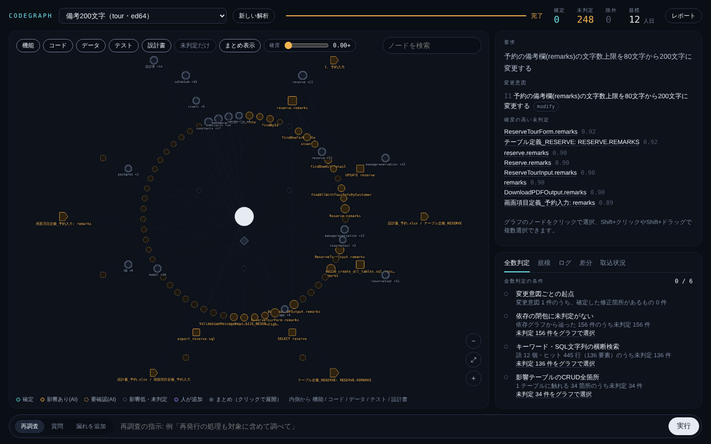

# codegraph — 要求からソースコードの影響範囲・修整規模を出す仕組み

要求仕様書の該当箇所やチャットの内容を投入すると、ソースコード・SQL・画面・メッセージ・DB・ジョブ・運用スクリプト・設計書（Excel/Word）のどこに影響するかを依存グラフで洗い出します。その過程はビュワーでリアルタイムに表示されます。

**このツールはソースコードを書き換えません。** 出力は「どこを直すか（影響範囲）」と「どれくらいかかるか（規模）」までです。

対象として想定しているのは、Java と Oracle / PostgreSQL を使い、ジョブスケジューラ（JP1 / cron）・運用シェル・Office 設計書を抱えた業務システム（SoR）のリポジトリです。特定のフレームワークに合わせたコードを書くのではなく、**フレームワークの知識を YAML のルールパックとして外出し**しています。そのため、社内フレームワークにもルールの追加だけで対応できます。



## このツールがやること・やらないこと

修整プロセス全体のうち、このツールが受け持つのは「影響範囲と規模を確定させる」ところまでです。

| # | 工程 | 担当 | 成果物 |
|---|---|---|---|
| 1 | 要求の受け取り（仕様書・チャット）／変更差分（MR・PR） | 人・ソース管理サーバ | 要求文／差分 |
| 2 | 影響候補の洗い出し | **このツール（解析エンジン）** | 影響候補の一覧（根拠・確度つき） |
| 3 | 候補の確認・判断の訂正・再調査 | **このツール（ビュワー）を使って人またはエージェント（MCP経由）** | 確定・除外の判断（理由つき） |
| 4 | 全数判定の条件を満たしたうえでの承認 | **このツール（ビュワー）を使って人** | 確定した影響範囲・規模・レポート |
| 5 | コードの修整 | 対象外（開発者、または Claude Code など） | 変更差分 |
| 6 | テスト・レビュー | 対象外。ただし MR/PR には回帰確認の範囲をコメントで返す | テスト結果 |
| 7 | 実績の振り返り（予測と実際の差分・工数） | 一部のみ（規模の補正係数APIで実績工数を登録できる） | 見積もり係数の補正 |

3 の「訂正」は、AIが出した影響候補の**判断を直す**こと（確定・除外・変更種別や難易度の補正・漏れの追加）を指します。ソースコードの修整ではありません。

## 仕組み

設計の詳細（要件・設計原則・部品の境界と契約・設計判断・制約・拡張手順）は [docs/ARCHITECTURE.md](docs/ARCHITECTURE.md) にあります。

```
 リポジトリ(git)  設計書(xlsx/docx/md)  ジョブ定義(JP1/cron)  DB辞書(Oracle/PG)  実行時SQL(pg_stat_statements/CSV)
       │               │                    │                   │                   │
       ▼               ▼                    ▼                   ▼                   ▼
 ┌─ 抽出（ファイル単位・並列・キャッシュ） ───────────────┐   ┌─ 取込（sources/） ─────────┐
 │ java / xml / text / sql / props / jobs / docs の汎用抽出器 │   │ catalog.py / runtime.py      │
 │   ＋ ルールパック（YAML）がフレームワークの意味を与える   │   └──────────────┬──────────┘
 │ → FileFacts: ノード・ファイル内の関係・「キーへの参照」   │                  │
 └──────────────┬─────────────────────────────┘                  │
                ▼                                                               ▼
 ┌─ リンク（全体） ───────────────────────────────────────────────┐
 │ キー一致 → 名前空間ごとの解決（型解決・URL・ビュー・プロパティパス・テーブル/列…） │
 │ すべての関係に 根拠(src) と 確度(conf)。解決できない参照・DBとDDLのずれ・        │
 │ コードに対応の無い実行時SQL を「取込状況」として報告                             │
 └──────────────┬────────────────────────────────────────────────┘
                ▼
 コード知識グラフ（ローカル JSON / Neo4j）── ブランチ・タグごとに別グラフ（抽出結果は共有）
                ▼
 解析エンジン: 要求の構造化 → 起点 → 伝播（ルールで重み付け）→ 判定 → 横断検索 → 独立再探索
              → CRUD確認（実行時SQL込み）→ 規模   ／ 差分モード: 変更行を含む要素 → 回帰確認範囲
                ▼
 ビュワー（REST + WebSocket）・CLI・MCP サーバ（エージェント向け）・Webhook（MR/PR にコメント）
```

### 1. 抽出: 汎用の抽出器と、意味を与えるルールパック

抽出器は言語・形式ごとに 7 つあり、どれもフレームワークを知りません。

| 抽出器 | 対象 | 取り出すもの |
|---|---|---|
| `java` | *.java（tree-sitter） | クラス・メソッド・フィールド、呼び出し・型・フィールドアクセスの記述子、アノテーション、文字列リテラル（同じクラスの定数経由も含む） |
| `xml` | *.xml | ルールパックの `xml:` ルールに従ってノード・参照を作る（パス・属性テンプレート・条件） |
| `text` | JSP・テンプレート・シェル・Groovy など | ルールパックの `text:` ルールの正規表現で参照を作る |
| `sql` | *.sql、および他の抽出器が見つけた SQL 文字列 | sqlglot で CRUD・列を解析（失敗時は正規表現）。CREATE TABLE・コメント・PL/SQL・PL/pgSQL のオブジェクト |
| `props` | *.properties・YAML | メッセージキー（全ロケール）・設定キー |
| `jobs` | JP1/AJS の定義（ajsprint 形式）・crontab | ジョブネット・ジョブ・先行関係・起動するスクリプト |
| `docs` | Excel・Word・Markdown（.xls/.doc は LibreOffice で変換） | 表の見出し行を自動で探し、行ごとに「設計書の項目」を作る。CRUD表（機能×テーブル）も検出 |

抽出結果は `FileFacts`（ノード、ファイル内の関係、`table:reserve` や `view:reservetour/reserveForm` のような**キーへの参照**）という共通形式で、ファイルごとに独立しています。そのため並列に処理でき、キャッシュも効きます。

フレームワークの知識は `backend/codegraph/rules/*.yaml` にあります。

| パック | 内容 |
|---|---|
| `java-common` | エンドポイントのアノテーション（Spring MVC・JAX-RS）、DI、テスト、文字列リテラルを照合する名前空間 |
| `jpa` | エンティティ・列・関連、@Query/@Select などの SQL、Spring Data の派生クエリ（`findByZipStartingWith` → `Customer.zip`） |
| `mybatis` | Mapper XML の statement・`<sql>`・`<include>`・resultMap、インターフェースとの結び付け |
| `spring-xml` | Bean 定義・プロパティ参照、Spring Batch の job/step/tasklet/chunk |
| `struts1` | action・form-bean・forward |
| `web-templates` | JSP / Thymeleaf / FreeMarker の項目バインド・メッセージ・リンク |
| `scripts-jobs` | シェルから起動される Java メインクラス・バッチジョブ・SQL（sqlplus/psql）・他スクリプト、読み書きするデータファイル、埋め込みSQL |
| `office` | 設計書の見出しの語彙（テーブル名・項目名(物理)・画面ID・ジョブ名…）と CRUD 記号 |
| `propagation` | 影響が伝わる関係・向き・重み（エンジンはこの表だけを見る） |

`CODEGRAPH_RULES` で指定したディレクトリのパックも読み込みます。`samples/rules/ofbiz.yaml` は、Apache OFBiz（エンティティエンジン・サービスエンジン・リクエストコントローラ・スクリーン・ラベル・Groovy）を**コードを1行も書かずに**ルールだけで取り込む例です。

#### 社内フレームワークへの対応例

SQL を名前付きで XML に置き、Java から `run("findOrder")` のように呼ぶフレームワークの場合、次のパックを置くだけで Java → SQL → テーブル・列 の経路がつながります（`backend/tests/test_mechanism.py` で検証）。

```yaml
name: inhouse
java:
  literal_namespaces: [q]          # Java の文字列リテラル（定数経由を含む）を q: キーとして照合
xml:
  - name: query
    when: {root: queries}          # ルート要素が <queries> のファイルだけ
    select: /queries/query
    node:
      kind: SqlStatement
      id: "q:{@name}"
      name: "{@name}"
      keys: ["q:{@name}"]
      sql: body                    # 本文を SQL として解析し、テーブル・列の READS/WRITES を作る
```

XML ルールのテンプレートには `{@attr}`（自要素の属性）・`{/@attr}`（ルート）・`{../@attr}`（親）・`{ancestor::tag@attr}`・`{text}`・`{file}` を使えます。`|` で代替（最初に値があるもの）、`:snake` `:lower` `:basename` などのフィルタも指定できます。ほかに `where`（属性条件）・`vars`（ファイルパスから正規表現で取り出す変数）・`links`（キー同士の関係）・`sql_skip`（SQL に含めない子要素）があります。テキストルールは正規表現と `{1}` などのグループ参照、`sql: true`（捕まえた文字列を SQL として解析）で書きます。

### 2. リンク: 根拠と確度つきの関係

参照のキーは、まず完全一致で、次に名前空間ごとの解決で関係になります。名前空間ごとの解決には次のものがあります。

- Java の型解決（入れ子・明示 import・同一パッケージ・ワイルドカード・一意な単純名）
- 受け手の型からのメソッド解決、インターフェース／抽象メソッドから実装への `IMPLEMENTED_BY`
- URL テンプレート、ビュー名の揺れ、`output.reserve.remarks` のようなプロパティパス
- テーブル・列（別名・候補テーブル）、ジョブ名、Bean 名、データファイル

すべての関係には次の 2 つが付きます。

- `src`: 根拠の種類。構文（parser）／ルール名（rule:mybatis）／DB辞書（catalog）／実行時（runtime）／設計書（doc）／推定（heuristic）
- `conf`: 確度

エンジンは「伝播ルールの重み × 確度」で影響の強さを計算します。

リンクの結果、グラフが**自分で分かっている欠け**を報告します（CLI `report`、API `/api/index/report`、ビュワーの「取込状況」タブ）。

- 解決できなかった参照（名前空間ごとの件数と例）。リポジトリに無いパッケージへの参照はライブラリとして別に数えます。
- DB辞書とリポジトリの DDL のずれ（DB にだけある列、DDL にだけある列、辞書に無いテーブル）
- 実行時SQLのうち、コード中のどの SQL とも対応しないもの（動的SQL・他システム・運用ツールといった静的解析の死角）

### 3. 増分・スナップショット・規模

- **抽出キャッシュ**: `facts.db`（SQLite）に (パス, git の blob SHA, 抽出器, 抽出器のコード, ルールのダイジェスト) をキーとして保存します。変更の無いファイルは再抽出しません。ルールや抽出器を直すと、影響する分だけ再抽出されます。
- **ワークスペース**: ブランチ・タグごとに git worktree を作り、別のグラフとして持てます（`graphs/<repo@ref>/`）。抽出キャッシュはグラフ間で共有します。
- **大規模向けの探索**: エンジンは BFS の 1 段ごとに近傍をまとめて取得します（`neighbors_many` / `get_many`）。Neo4j ストアでは 1 段 1 クエリ（UNWIND）になります。

### 4. 解析エンジン

| 工程 | 内容 |
|---|---|
| 要求の構造化 | Claude（APIキーがあるとき）またはルールベースで変更意図に分ける（追加／変更／削除、値の変更、新しい語） |
| 起点 | 識別子の一致、用語集、変更前の値（「80文字」→ 80 を持つ要素）、類似度 |
| 伝播 | `propagation.yaml` の関係・向き・重みで閉包を計算。設計書・テスト・SQLファイルなどは終端（SQLファイルはそれを起動するジョブへは伝わる） |
| 判定 | 確度・理由・変更種別 |
| 横断検索 | 起点の語でリポジトリ全体を検索（既定は git grep。`CODEGRAPH_CODESEARCH` で Zoekt・GitLab のコード検索に切り替え、ソース管理サーバ側の全ブランチ・全リポジトリを対象にできる） |
| 独立再探索 | 依存グラフを使わない別戦略で探し、本探索と突き合わせる |
| CRUD確認 | 影響テーブルを読み書きする全箇所（コード・SQL・ジョブ・設計書の CRUD 表・実行時SQL） |
| 規模 | 係数表 ＋ 複雑度・行数・呼び出し元数・テスト有無・ロケール数 |

**差分モード**: 2 つの ref の差分（MR と同じく merge-base からの差分）の変更行を含む要素を起点にして、回帰確認の範囲（実行すべきテスト・画面・ジョブ・設計書）を出します。

## ソース管理サーバとの連携

- **Webhook**（`POST /api/hooks/git`）: GitLab・GitHub の push と MR/PR を受けます（`CODEGRAPH_WEBHOOK_SECRET` で GitLab トークン／GitHub の HMAC 署名を検証）。
  - push: そのブランチのグラフを更新します（変更ファイルだけ再抽出）。
  - MR/PR: ターゲットブランチのグラフで差分モードを実行し、`GITLAB_TOKEN` / `GITHUB_TOKEN` があれば回帰確認の範囲を MR/PR にコメントします。
- **コード検索**: `CODEGRAPH_CODESEARCH=zoekt:http://zoekt:6070` または `gitlab:https://gitlab.example.com/api/v4:<project id>`
- **MCP サーバ**（`codegraph mcp`、stdio）: Claude Code などのエージェントが次のツールでグラフを使えます。
  - `list_graphs`・`search_elements`・`get_element`・`neighbors`
  - `analyze_requirement`・`analyze_change`・`index_gaps`

  リポジトリの近くで動かせば、コードをネットワーク外に出さずに構造だけを渡せます。

SVN は対象外です（git 前提。必要なら git-svn で移行・ミラーしてください）。

## 起動

### ローカル（開発）

```bash
cd backend
pip install -e .            # `codegraph` コマンドが使えるようになる（python -m codegraph.cli でも同じ）
export CODEGRAPH_DATA_DIR=./data

# インデックス（設計書・ジョブ定義・運用シェルのフォルダは --docs）
codegraph index --repo /path/to/repo --docs /path/to/ops-and-docs [--ref release/1.2]

# DB辞書と実行時SQL（任意。取り込んだら index をやり直すとリンクされる）
codegraph catalog postgres --dsn "postgresql://user@host/db" --name proddb
codegraph catalog oracle --csv-dir ./dict_export --name ora      # ALL_TAB_COLUMNS 等の CSV
codegraph catalog oracle --dsn host:1521/svc --user u --password p --owner APP --name ora
codegraph runtime --pg "postgresql://user@host/db" --name prod-rt  # pg_stat_statements
codegraph runtime --csv sql_stats.csv --name ora-rt               # V$SQL などのエクスポート

codegraph report                       # 取込状況（未解決・ずれ・実行時SQLの対応）
codegraph analyze "要求文"            # 要求から
codegraph diff --base main --head feature/x   # 差分から（回帰確認の範囲）
codegraph serve --port 8765            # ビュワー http://localhost:8765
codegraph mcp                          # MCP サーバ（stdio）
```

ビュワーの開発サーバは `cd frontend && npm install && npm run dev` で起動します（ビルド済みなら backend が `frontend/dist` を配信します）。

`serve` は既定で 127.0.0.1 だけで待ち受けます。ほかのマシンから使う場合は `CODEGRAPH_API_TOKEN` と `CODEGRAPH_ALLOWED_HOSTS` が必要です（無いと起動しません）。

### Docker（Neo4j 構成）

```bash
cp .env.example .env          # CODEGRAPH_API_TOKEN・NEO4J_PASSWORD（必須）、ANTHROPIC_API_KEY・REPOS_DIR など
docker compose up --build     # http://localhost:8765/?token=<CODEGRAPH_API_TOKEN> で一度開く
```

## セキュリティ

このサーバはソースコードと設計書を返すため、次の対策を入れています。

- 既定では同一オリジン・ローカルのホスト名からのアクセスだけに応答する
- トークン認証（ビュワーは HttpOnly クッキー）
- 読めるファイルはリポジトリと設計書フォルダの中に限る
- API で指定できるパスは許可ルート配下に限る
- Webhook には署名を必須にする
- 細工されたリポジトリへの防御: シンボリックリンク、巨大ファイル、XML の実体参照、zip 爆弾
- エラー応答から内部情報・資格情報を除く

想定する脅威・設定・残っているリスク・エラー処理の方針は [docs/SECURITY.md](docs/SECURITY.md) にあります。

## ビュワーでできること（上の表の工程 2〜4）

すべて影響範囲を確定させるための操作で、コードを編集する機能はありません。

| やりたいこと | 操作 |
|---|---|
| 解析の進行をリアルタイムに見る | 解析中はノードが内側から増え、ヘッダーに工程と進捗、ログタブに手順が流れる |
| 大量の候補を見通す | 候補が 150 件を超えると、確度の低い候補をモジュール・領域ごとに 1 つのノードにまとめる（クリックで展開。確度の高いもの・判断済み・選択中は常に表示） |
| 本当に影響があるか確かめる | ノードをクリック → 根拠（要求からの経路）・コード（該当行をハイライト）・設計書・テスト・履歴。参照元・参照先には関係の根拠（構文・規則・DB辞書・実行時・設計書・推定）と確度を表示 |
| 周辺コードを辿る | 「参照元・呼び出し元／参照先」から移動。グラフに無い要素は「＋追加」で影響ありとして追加し、そこから追跡を再実行 |
| AIの判断を直す | 影響ありで確定／除外（理由必須）／未判定に戻す、変更種別・難易度の補正、複数選択でまとめて判断 |
| 漏れを指摘する・再調査させる・質問する | 指示バーの「漏れを追加」「再調査」「質問」 |
| グラフの欠けを知る | 「取込状況」タブ: 解決できなかった参照、DB辞書とDDLのずれ、コードに対応の無い実行時SQL |
| 差分から始める | 「新しい解析」→「変更差分から」で比較元・変更後を指定 |
| 全数として確定する | 全数判定タブの条件をすべて満たすと承認できる。判断を変えると承認は自動で外れる |
| 規模を見る・報告する | 規模タブ、レポート（Markdown） |

## 「これで全数」の判断

100%の網羅は証明できないため、**定義した探索範囲に未判定が残っていないこと**を全数の定義にしています。

1. **変更意図ごとの起点**: 変更意図すべてに、確定した修正箇所がある
2. **依存の閉包に未判定がない**: 依存グラフで辿った候補がすべて確定か除外
3. **キーワード・SQL文字列の横断検索**: 起点の語でヒットした要素がすべて判定済み
4. **影響テーブルのCRUD全箇所**: 影響テーブルを定義・投入・マッピング・検索する箇所がすべて判定済み
5. **独立した再探索との突き合わせ**: 別戦略で見つけた要素がすべて判定済み
6. **実行時SQLとの突き合わせ**（実行時SQLを取り込んだ場合）: 影響テーブルに実際に触れた SQL がすべて判定済み。コードに対応が無い SQL は、静的解析では見えない利用者がいることを示す

あわせて「取込状況」のずれ・未解決参照も確認できます。

## AIの使用量と設定

AI（Claude）を使うのは「要求の構造化」と「候補の判定」と「ビュワーでの質問」だけです。インデックス作成や、ビュワーでの閲覧・確定・除外には使いません。判定は候補数に比例してトークンを使うため、次の3つで量を抑えます。

| 仕組み | 内容 | 設定（既定値） |
|---|---|---|
| 再調査での判定の再利用 | 親の解析でAIが判定した候補は判定し直さない。新しい根拠で点数が一定以上上がった候補だけ再判定する | `reuse_verdicts`（true）、`rescore_delta`（0.1） |
| 低スコアはルールで判定 | 点数が閾値未満の候補はAIに送らない | `min_score`（0.3） |
| 1回あたりの上限 | 点数の高い順に上限件数までAIで判定し、残りはルールで判定する（要確認として残る） | `max_items`（300。`unlimited` または -1 で上限なし、0 でAI判定なし） |

あわせて、横断検索・独立再探索・CRUD確認で見つかった候補も、1件ずつではなくまとめて判定するようにしました（`batch_size`、既定 15 件／回）。

**設定の場所**（下ほど優先）:

1. 設定ファイル `<CODEGRAPH_DATA_DIR>/settings.yaml`（場所は `CODEGRAPH_SETTINGS` で変更可）。例は `samples/settings.example.yaml`
2. 環境変数 `CODEGRAPH_LLM_MIN_SCORE`・`CODEGRAPH_LLM_MAX_ITEMS`・`CODEGRAPH_LLM_REUSE_VERDICTS`・`CODEGRAPH_LLM_RESCORE_DELTA`・`CODEGRAPH_LLM_BATCH_SIZE`
3. 解析ごとの指定:
   - API の `llm_max_items` / `llm_min_score`
   - CLI の `--llm-max-items` / `--llm-min-score`
   - MCP の `llm_max_items`
   - ビュワーの「新しい解析」の入力欄

解析ごとの内訳（AIで判定・再利用・ルール判定・API呼び出し回数・実際の入出力トークン数）は、ビュワーの「規模」タブ、CLI の出力、API の `llm_usage` で確認できます。現在の既定値は `GET /api/settings/llm` で確認できます。

**測定結果**（ツアー予約の「備考 80→200文字」、候補 243 件）: Claude の呼び出し部分を記録用に差し替えて送信内容を数えたもので、トークン数は文字数からの換算です。

| 条件 | AIで判定 | API呼び出し | トークン（入力＋出力） |
|---|---|---|---|
| 変更前（1件ずつの判定あり、再利用なし） | 243 | 102 回 | 約 88,000 |
| 上限なし・閾値 0 | 243 | 19 回 | 約 78,000 |
| 既定（閾値 0.3・上限 300） | 216 | 17 回 | 約 71,000 |
| 閾値 0.4 | 59 | 5 回 | 約 20,000 |
| 閾値 0.5 | 25 | 3 回 | 約 8,500 |
| 上限 100 | 100 | 8 回 | 約 32,000 |
| 再調査（既定、変更前は約 78,000） | 4（212 件は再利用） | 2 回 | 約 3,600 |

閾値や上限を下げるほど、ルールで判定されて「要確認」のまま残る候補が増え、人の確認の手間が増えます。既定値は網羅を優先した値です。

## 規模見積もり

`backend/codegraph/analysis/estimate.py` の係数表（要素種別 × 変更種別の基準時間。ジョブ・スクリプト・SQL文・DBオブジェクト・設計書の項目も含む）を基準にします。これに循環的複雑度・行数・呼び出し元数・難易度補正・ロケール数を掛け、テストが無い要素にはテスト作成時間を加えます。最後にレビュー等の係数（既定 1.3）と、過去実績から求める補正係数（`POST /api/estimator/calibrate`）を掛けて人日にします。

## API

| メソッド | パス | 用途 |
|---|---|---|
| GET | /api/status・/api/graphs | 状態・グラフ（ブランチ・タグごと）一覧 |
| GET | /api/settings/llm | AI判定の既定の閾値・上限 |
| POST | /api/index | インデックス（repo, docs_dir, ref, graph） |
| GET | /api/index/report | 取込状況（未解決参照・ずれ・実行時SQLの対応・エラー） |
| POST | /api/sources/catalog・/api/sources/runtime | DB辞書・実行時SQLの取込 |
| POST | /api/runs | 要求から解析（`llm_max_items`・`llm_min_score` で今回だけAIの上限・閾値を変更） |
| POST | /api/runs/diff | 差分から解析（base, head） |
| GET | /api/runs/{id}・/api/runs/{id}/scope | 状態・回帰確認の範囲（Markdown 付き） |
| WS | /ws/runs/{id} | イベントストリーム |
| POST | /api/runs/{id}/decisions(/bulk)・candidates・reinvestigate・approve・ask・comments | 人の操作 |
| GET | /api/runs/{a}/diff/{b}・/api/runs/{id}/report | run の差分・レポート |
| GET | /api/nodes/{id}・/api/search | ノード詳細・検索 |
| POST | /api/hooks/git | GitLab / GitHub の Webhook |
| POST | /api/estimator/calibrate | 規模の補正係数 |

## 検証結果

判定はすべてルールベース（APIキー無し）です。

### TERASOLUNA ツアー予約（MyBatis3・JSP・PostgreSQL）＋ 周辺資産

[terasoluna-tourreservation-mybatis3](https://github.com/terasolunaorg/terasoluna-tourreservation-mybatis3) には業務システムで典型的な周辺資産がありません。そこで、次のものを検証用に作成して加えました（`samples/tour-env`、公式資料ではありません）。

- JP1 ジョブ定義・crontab・運用シェル（psql、連携ファイル、ヒアドキュメントの DELETE）
- Excel のテーブル定義・画面項目定義・CRUD 表、Word の基本設計書
- DB にだけ当てた列・ビュー・関数・トリガー
- 実行時SQL

インデックス結果は次のとおりです。

- 201 ファイル → 1,743 ノード・5,214 関係（0.6 秒）、解決できない参照は 0 件
- DB辞書（PostgreSQL 16）との比較で、DB にだけある列 `customer.customer_rank` を検出
- 実行時SQL 8 件のうち 5 件がコード中の SQL と対応。残り 3 件（コードに無い集計 SQL、DB にだけあるビューの参照、件数取得）を死角として報告

**要求「予約の備考欄(remarks)の文字数上限を80文字から200文字に変更する」**（正解 18 項目は `eval/tour_remarks_check.py`）:

| | 結果 |
|---|---|
| 候補に入った正解 | 18 / 18 |
| うち AI 判定「影響あり」 | 15 / 18（完了画面 JSP は要確認、ジョブ J010 と初期データ投入関数は影響低） |
| 候補数 | 248（影響あり 29・要確認 191・影響低 28） |

経路の例:

- フォーム `@Size` → メッセージキー → 定数クラス
- Entity → Mapper XML の各 statement → 列 → DDL・Excel のテーブル定義行・画面項目定義行・Word の節
- PDF 出力用 DTO → PDF ビュー
- 列 → 夜間ジョブの SQL（export_reserve.sql）→ それを起動するシェル → JP1 ジョブ

**履歴による評価**（`backend/scripts/eval_history.py`）: 書式変更・バージョン更新などを除いた直近 25 コミット（変更ファイル計 92）を対象にしました。コミットメッセージを要求として親コミットの時点で解析し、実際に変更されたファイルが候補に入ったかを見ています。

| 指標 | 値 |
|---|---|
| 候補に入った変更ファイルの割合 | 73.9% |
| AI 判定「影響あり」に入った割合 | 22.8% |
| 1 件以上当たったコミット | 23 / 25 |
| 候補数（中央値） | 114 |

コミットメッセージは「fix #123」のように短く、要求文の代わりとしては不利な条件です。網羅は候補一覧とレビューで担保し、「影響あり」の絞り込みはルールベースでは弱い、という傾向がここでも出ています。

**差分モード・Webhook・MCP**:

- フォームの `@Size(max = 80)` を 200 にしたブランチの GitLab MR イベントを送り、署名検証 → ベースブランチのグラフ作成 → 回帰確認の範囲（画面 2・テスト 10・設計書の節）の生成までを確認しました。
- MCP は stdio の実クライアントから 7 ツールすべてを呼び出して確認しました。

### Apache OFBiz（規模・未知のフレームワーク）

`samples/rules/ofbiz.yaml` だけで取り込み、Java・Groovy・XML・FTL を含む 3,515 ファイルを処理しました（2 CPU）。

| 条件 | 結果・時間 |
|---|---|
| 初回 | 57,722 ノード・203,503 関係、19.4 秒（抽出 10.0 秒・リンク 4.8 秒） |
| 変更なし | 11.2 秒（再抽出 0、残りはキャッシュ読込・リンク・グラフ書き出し） |
| 1 ファイル変更 | 11.9 秒（再抽出 1） |
| 解決できない参照 | screen 28・method 7・service 2・file 1 |

### Spring PetClinic

v1 からの回帰確認です。正解リストは `eval/ground_truth.json`、手順は `python eval/run_eval.py --repo <petclinic> --docs samples/petclinic-design --decisions eval/decisions.json`。

| 要求 | 候補数 | 候補の必須網羅率 | AI判定「影響あり」の必須網羅率 / 適合率 | レビュー後の必須網羅率 / 適合率 | 規模 |
|---|---|---|---|---|---|
| R1 オーナーにメールアドレス追加 | 135 | 100% | 100% / 61% | 100% / 85% | 3.0人日 |
| R2 電話番号の桁数チェック変更 | 108 | 100% | 80% / 19%（検証テストが要確認止まり） | 100% / 53% | 1.4人日 |
| R3 獣医一覧のページサイズ変更 | 88 | 100% | 100% / 31% | 100% / 67% | 0.5人日 |

### テスト

`backend/tests`（31 件、すべてオフライン）:

- 小さな固定リポジトリでの一連の操作
- 一時リポジトリでの仕組みの検証: 社内フレームワークのルールパック、JP1→シェル→データファイル→後続ジョブ、Excel の見出し検出と CRUD 表、DB辞書のずれと実行時SQLの対応、キャッシュの増分、差分モード、Webhook の解釈、SQL の端のケース
- AI判定の予算（`test_llm_budget.py`）: 再調査での再利用、閾値、上限、上限なし、設定ファイル・環境変数・解析ごとの指定の優先順位
- 攻撃が失敗することの確認（`test_security.py`）: ファイル読み取りの迂回、CORS・Host 偽装・クロスサイト WebSocket、認証、パス制限、Webhook 偽装、シンボリックリンク、XXE、zip 爆弾

Oracle 辞書の CSV 取込（`samples/tour-env/db/oracle_catalog`）は、パッケージ本体の CRUD と DB にだけある列 `reserve.cancel_reason` の検出までを確認しました。

## 既知の制約

- **実機未検証のもの**: Neo4j ストアと Docker 構成、Oracle への直接接続、Zoekt・GitLab のコード検索、MR/PR へのコメント投稿、Claude 判定。作成環境から Docker Hub・Maven Central・外部サービスに接続できなかったためです。ローカルストアと同じインターフェースのテストは通っていますが、初回は実機での確認が必要です。
- **評価の独立性**: 周辺資産（ジョブ・設計書・DB にだけある改修）と正解リストは同じ作り手（Claude）が用意したもので、独立した評価ではありません。社内の実案件で、有識者が作った正解と突き合わせる評価が次の段階です。
- **ルールベース判定の絞り込みは弱い**: 候補の網羅は高い一方、「影響あり」の適合率・履歴評価の再現率は低めです。Claude 判定かレビューが前提です。
- **言語の範囲**: Java の型解決は javac 相当の簡易版（ジェネリクスの推論・ラムダの型は追わない）。COBOL・C#・PL/SQL の手続き内部の制御フローは対象外です。PL/SQL・PL/pgSQL は CRUD とオブジェクト単位で扱います。
- **設計書**: 表の見出し行を語彙で探す方式です。結合セルが多い帳票型や図だけの設計書からは取り出せません。`.xls` / `.doc` には LibreOffice が必要です。
- **静的解析の限界**: リフレクション・動的SQL・外部システム連携は依存グラフでは追えません。横断検索・独立再探索・実行時SQLとの突き合わせで補う形です。
- **規模の係数は初期値**です。実績の登録による補正が前提です。
- **修整工程とは未接続**（上の表の工程 5〜7）: 承認済みの影響一覧を MCP 経由で Claude Code などに渡して修整案を作り、実際の差分を予測と突き合わせて係数に戻す、という接続が次の拡張候補です。

## ディレクトリ

```
backend/codegraph/extractors/         汎用の抽出器（java / xml / text / sql / props / jobs / docs）
backend/codegraph/rules/              ルールパック（YAML）: フレームワークの知識と伝播の重み
backend/codegraph/pipeline/           抽出の実行・キャッシュ・リンク（名前空間ごとの解決・Java の型解決）
backend/codegraph/sources/            DB辞書・実行時SQL・git（worktree・差分・Webhook）・コード検索
backend/codegraph/store/              ローカルストア / Neo4jストア（グラフ名前空間・一括取得）
backend/codegraph/analysis/           解析エンジン・LLM／ルールベース判定・規模見積もり
backend/codegraph/workspace.py        複数グラフ（ブランチ・タグ）の管理
backend/codegraph/api.py・cli.py・mcp_server.py   REST + WebSocket / コマンドライン / MCP
backend/scripts/eval_history.py    コミット履歴による評価
backend/tests/                     テスト
frontend/src/                      ビュワー
samples/rules/                     追加ルールパックの例（OFBiz）
samples/tour-env/                  検証用の周辺資産（ジョブ・シェル・Office 設計書・DB 改修・実行時SQL）
samples/petclinic-design/          検証用のサンプル設計書（v1）
eval/                              正解リスト・評価スクリプト・結果
docs/screenshots/                  画面の記録
```
