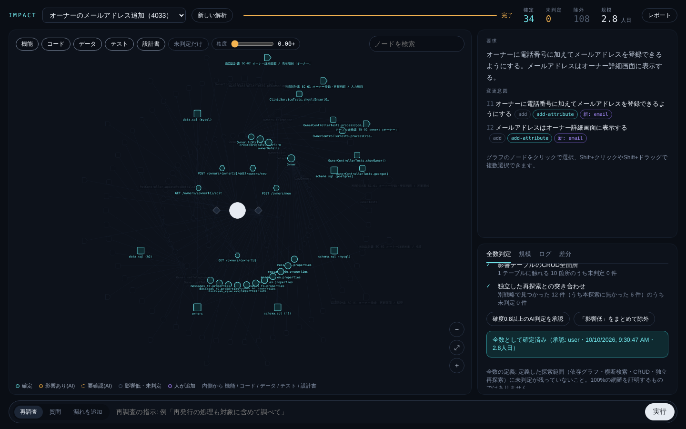

# Impact Analyzer — 要求からソースコードの影響範囲・修整規模を出す仕組み

要求仕様書の該当箇所やチャットの内容を投入すると、ソースコード・SQL・画面テンプレート・メッセージ・テスト・設計書のどこに影響するかを依存グラフで洗い出し、その過程をビュワーでリアルタイムに表示します。
人（またはエージェント）が候補を確認・修正・再調査し、「全数判定の条件」をすべて満たしたら承認する、という流れで影響範囲と規模を確定させます。



## 構成

```
要求仕様書・チャット
      │
      ▼
┌──────────── 解析エンジン（backend/impact/analysis） ────────────┐
│ 1 要求の構造化   LLM（Claude）/ ルールベース → 変更意図           │
│ 2 起点探索       識別子一致・変更パターン・変更前の値・類似度      │
│ 3 依存の追跡     型付きの伝播ルールで閉包を計算                    │
│ 4 判定           確度・理由・変更種別                              │
│ 5 横断検索       全テキストファイルをキーワードで総なめ（盲点対策）│
│ 6 独立再探索     別戦略で探索し本探索と突き合わせ                  │
│ 7 CRUD確認       影響テーブルを読み書きする全箇所                  │
│ 8 規模算出       係数表＋複雑度・行数・呼び出し元数・テスト有無    │
└───────┬──────────────────────────────┬──────────────────────┘
        │ イベント（WebSocket）         │ 状態・判断（REST）
        ▼                              ▼
   ビュワー（frontend, React + Cytoscape.js）        Run/イベント保存（SQLite）
        ▲
コード知識グラフ（Neo4j または ローカルストア）  ← インデクサ（tree-sitter）
   要求 / 機能(エンドポイント) / クラス・メソッド・フィールド / テンプレート /
   テーブル・列・SQLファイル / メッセージ / テスト / 設計書の節
```

- **インデクサ**（`backend/impact/indexer`）: tree-sitter で Java を解析し、呼び出し・型参照・フィールドアクセス・Spring のエンドポイント・JPA の列対応・Spring Data の派生クエリ・定数経由のビュー名を解決します。Thymeleaf テンプレートの項目バインド、SQL（CREATE TABLE と INSERT の列順依存）、メッセージバンドル（全ロケール）、テストからの URL・項目名リテラル、Markdown 設計書の言及、git の変更履歴もグラフに入れます。
- **グラフストア**（`backend/impact/store`）: `IMPACT_STORE=neo4j` で Neo4j、未指定ならローカル（JSON永続化）。エンジンは同じインターフェースだけを使います。
- **LLM**（`backend/impact/analysis/llm.py`）: `ANTHROPIC_API_KEY` があれば要求の構造化・候補の判定・自由質問に Claude を使い、無ければルールベースで全工程が動きます。
- **ビュワー**（`frontend`）: 要求を中心に、内側から 機能 / コード / データ / テスト / 設計書 の同心円で影響が広がる様子を表示します。

## 起動

### ローカル（開発）

```bash
# バックエンド
cd backend
pip install -r requirements.txt
python -m impact.cli serve --port 8765        # http://localhost:8765

# ビュワー（開発サーバ。ビルド済みなら不要: backend が frontend/dist を配信）
cd ../frontend
npm install && npm run dev                     # http://localhost:5173
```

画面の「新しい解析」でリポジトリのパス（と任意で設計書フォルダ）を指定してインデックスを作り、要求を貼り付けて開始します。

コマンドラインだけでも使えます。

```bash
python -m impact.cli analyze --repo /path/to/repo --docs /path/to/design-docs "要求文"
```

### Docker（Neo4j 構成）

```bash
cp .env.example .env          # ANTHROPIC_API_KEY と REPOS_DIR を設定
docker compose up --build     # http://localhost:8765 、リポジトリは /repos/<名前> で指定
```

## ビュワーでできること

| やりたいこと | 操作 |
|---|---|
| 解析の進行をリアルタイムに見る | 解析中はノードが内側から増え、ヘッダーに工程と進捗、ログタブに手順が流れる |
| 本当に影響があるか確かめる | ノードをクリック → 根拠（要求からの経路）・コード（該当行をハイライト）・設計書・テスト・履歴 |
| 周辺コードを辿る | コードタブの「参照元・呼び出し元／参照先」から移動。グラフに無い要素は「＋追加」で影響ありとして追加し、そこから追跡を再実行 |
| 結果を直す | 影響ありで確定／除外（理由必須）／未判定に戻す、変更種別・難易度の補正、複数選択でまとめて判断 |
| 漏れを指摘する | 指示バーの「漏れを追加」に要素名を入れる |
| 再調査させる | ノードを選んで指示バー「再調査」に指示（例:「設計書と照合して」「DBまで追って」）。前回の判断を引き継いだ新しい run ができ、差分タブで比較 |
| 質問する | ノードを選んで「質問」（Claude 接続時） |
| 確認を分担する | コメントタブで確認担当とコメントを記録 |
| 全数として確定する | 全数判定タブの5条件をすべて満たすと承認できる。判断を変えると承認は自動で外れる |
| 規模を見る | 規模タブ。要素ごとの工数と内訳、未判定分の期待値と幅 |
| 報告する | レポート（Markdown）をダウンロード |

## 「これで全数」の判断

100%の網羅は証明できないため、**定義した探索範囲に未判定が残っていないこと**を全数の定義にしています。

1. **変更意図ごとの起点**: 要求から抽出した変更意図すべてに、確定した修正箇所がある
2. **依存の閉包に未判定がない**: 依存グラフで辿った候補がすべて確定か除外
3. **キーワード・SQL文字列の横断検索**: 起点の識別子で全テキストファイルを検索し、ヒットした要素がすべて判定済み（動的呼び出し・SQL文字列・設定ファイルなど静的解析の盲点を補う）
4. **影響テーブルのCRUD全箇所**: 影響するテーブルを定義・投入・マッピング・検索する箇所がすべて判定済み
5. **独立した再探索との突き合わせ**: 依存グラフを使わない別戦略で見つけた要素がすべて判定済み

承認は誰がいつ行ったかを記録し、その後に判断を変えると承認は外れます。

## 規模見積もり

`backend/impact/analysis/estimate.py` の係数表（要素種別 × 変更種別の基準時間）に、循環的複雑度・行数・呼び出し元数・難易度補正・ロケール数を掛け、テストが無い要素にはテスト作成時間を加えます。レビュー等の係数（既定 1.3）と、過去実績から求める補正係数を掛けて人日にします。

```bash
# 過去の (予測, 実績) から補正係数を更新
curl -X POST localhost:8765/api/estimator/calibrate -H 'content-type: application/json' \
  -d '{"history":[{"predicted_days":2.0,"actual_days":2.6}]}'
```

## API

| メソッド | パス | 用途 |
|---|---|---|
| POST | /api/index | リポジトリ（と設計書フォルダ）をインデックス |
| POST | /api/runs | 解析を開始 |
| GET | /api/runs/{id} | 状態（候補・判定・全数条件・規模） |
| WS | /ws/runs/{id} | イベントストリーム（過去分を再生してから新着を配信） |
| POST | /api/runs/{id}/decisions(/bulk) | 確定・除外・未判定に戻す、変更種別・難易度 |
| POST | /api/runs/{id}/candidates | 漏れの追加（そこから追跡を再実行） |
| POST | /api/runs/{id}/reinvestigate | 再調査（前回の判断を引き継いだ新しい run） |
| GET | /api/runs/{a}/diff/{b} | run の差分 |
| POST | /api/runs/{id}/approve | 全数として承認（条件未達なら 409） |
| POST | /api/runs/{id}/ask | 選択ノードについて質問 |
| GET | /api/runs/{id}/report | Markdown レポート |
| GET | /api/nodes/{id} | ノード詳細（コード・参照元/先・設計書・テスト・履歴） |

## 検証結果（Spring PetClinic）

[spring-projects/spring-petclinic](https://github.com/spring-projects/spring-petclinic)（commit 500158f、Java 50ファイル）に、検証用に書き起こした設計書4本（`samples/petclinic-design`）を加えて評価しました。インデックスは 500ノード・2,159関係で 0.2 秒です。正解リストは `eval/ground_truth.json`、再現手順は `python eval/run_eval.py --repo <petclinic> --docs samples/petclinic-design --decisions eval/decisions.json`。

| 要求 | 候補数 | 候補の必須網羅率 | AI判定「影響あり」の必須網羅率 / 適合率 | レビュー後の必須網羅率 / 適合率 | 全数条件 | 規模 |
|---|---|---|---|---|---|---|
| R1 オーナーにメールアドレス追加 | 142 | 23/23 | 100% / 57%（47件） | 100% / 85% | 5/5 承認 | 2.8人日 |
| R2 電話番号の桁数チェック変更 | 92 | 5/5 | 100% / 19%（31件） | 100% / 53% | 5/5 承認 | 1.3人日 |
| R3 獣医一覧のページサイズ変更 | 68 | 2/2 | 100% / 27%（11件） | 100% / 67% | 5/5 承認 | 0.4人日 |

- 判定はルールベース（APIキー無し）で実施。R1 では列順依存の INSERT がある data.sql（h2・mysql）と、列名指定で修正不要な postgres 版を区別して拾えています。
- レビュー後の適合率は、正解リストに無い「機能（エンドポイント）」の確定や、R2 で全ロケールのファイルを確定した分を誤りとして数えた厳しめの値です。
- 「レビュー」は Claude がエージェント役として候補とコードを確認して判断したもの（`eval/decisions.json`、理由付き）です。

## 既知の制約と次の一手

- **評価の独立性**: 正解リストもレビュー判断も同じ作り手（Claude）によるもので、独立した評価ではありません。社内の実案件で、有識者が作った正解と突き合わせる評価が次の段階です。
- **ルールベース判定の適合率は低い**（19〜57%）。候補の網羅には効きますが、絞り込みは Claude 判定かレビューが前提です。Claude 連携部分はAPIキーが無い環境で作ったため未検証です。
- **Neo4j ストアと Docker 構成は実機未検証**: 作成環境のネットワーク方針で Docker Hub と Maven Central に接続できず、Neo4j を起動できませんでした。ローカルストアと同じインターフェースのテストは通っていますが、初回は Neo4j 実機での確認が必要です。Neo4j 利用時は近傍取得が往復になるため、大規模リポジトリではキャッシュ層の追加を検討してください。
- **対応範囲**: Java/Spring・Thymeleaf・SQL・properties・Markdown 設計書。JSP/COBOL/PL/SQL、Excel・Word の設計書は未対応（インデクサの追加で拡張する設計）。
- **静的解析の限界**: リフレクション・動的SQL・外部システム連携は依存グラフでは追えず、横断検索と独立再探索で補う形です。
- **規模の係数は初期値**です。実績の登録による補正が前提です。

## ディレクトリ

```
backend/impact/model.py            グラフのノード・関係の定義
backend/impact/indexer/            Java（tree-sitter）・テンプレート・SQL・メッセージ・設計書のインデクサ
backend/impact/store/              ローカルストア / Neo4jストア
backend/impact/analysis/engine.py  解析の各工程・全数条件・人の操作・再調査・差分・レポート
backend/impact/analysis/llm.py     Claude / ルールベースの切り替え
backend/impact/analysis/estimate.py 規模見積もり
backend/impact/api.py              REST + WebSocket
backend/impact/cli.py              コマンドライン
backend/tests/                     テスト（小さな固定リポジトリで実行）
frontend/src/                      ビュワー
eval/                              正解リスト・レビュー判断・評価スクリプト・結果
samples/petclinic-design/          検証用のサンプル設計書
docs/screenshots/                  画面の記録
```
