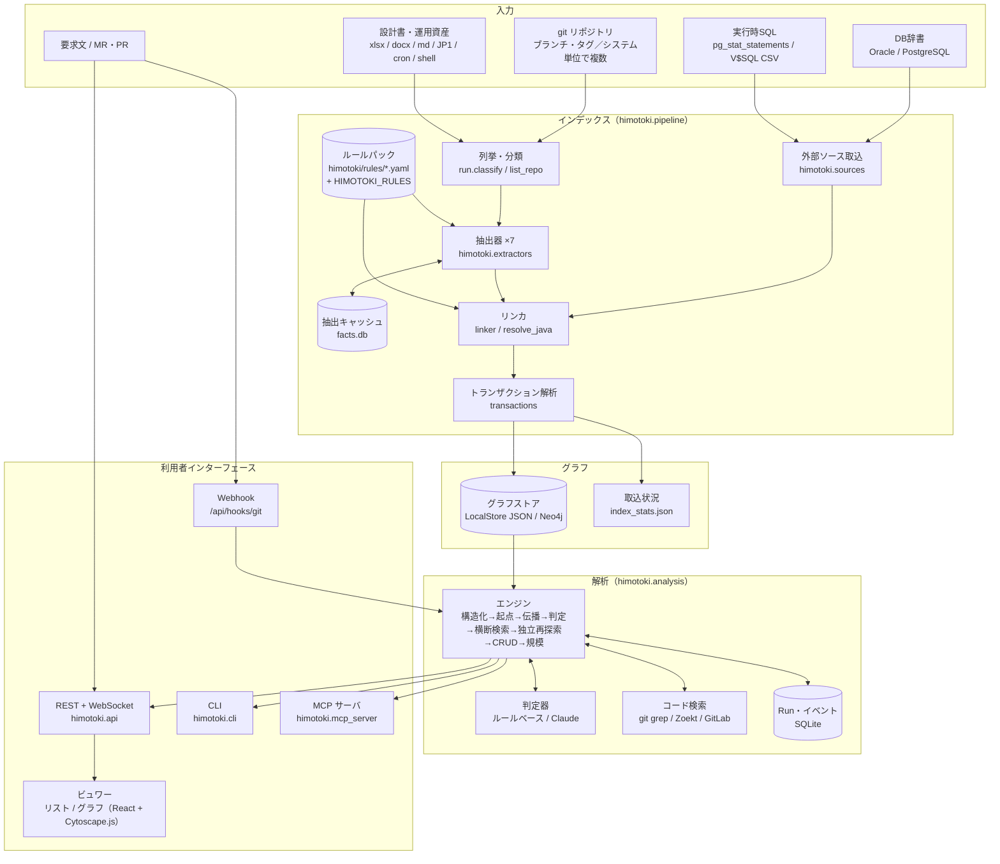
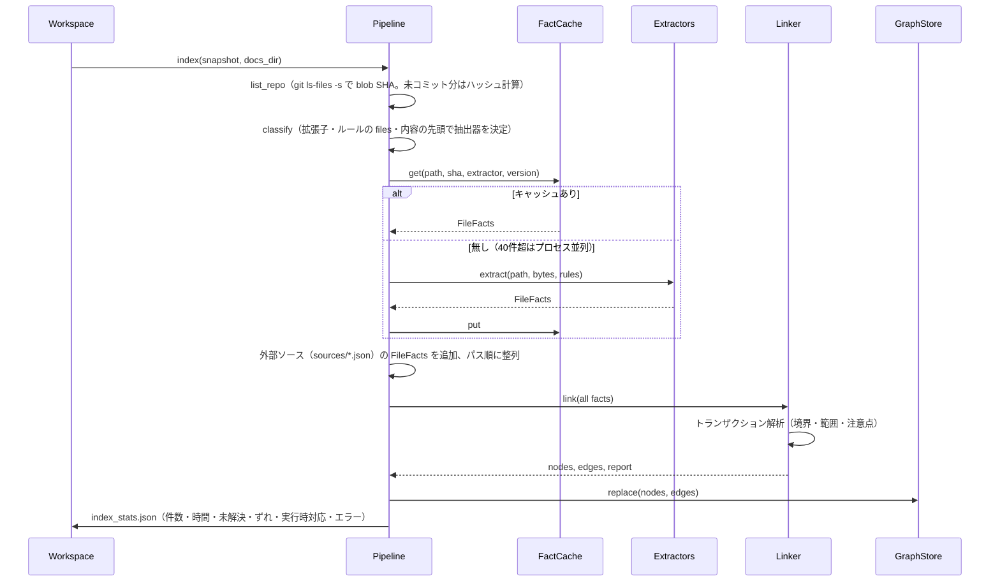
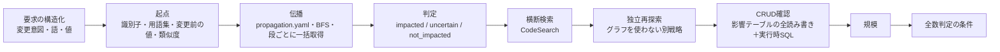
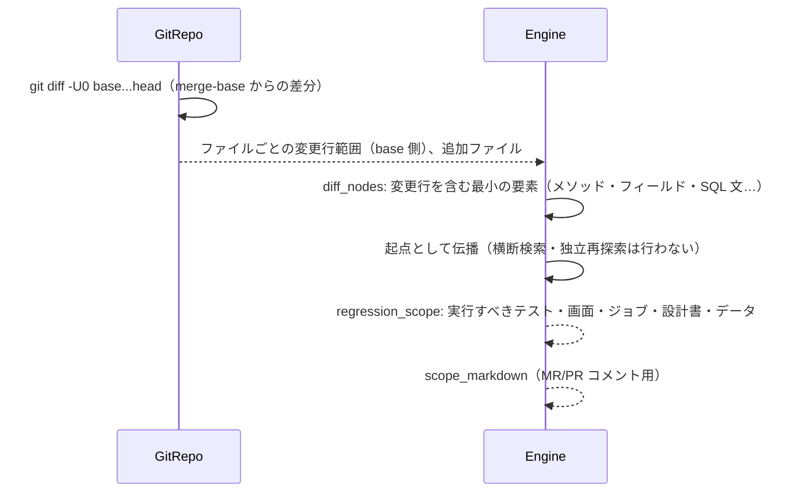
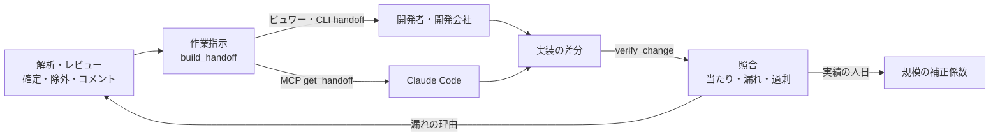
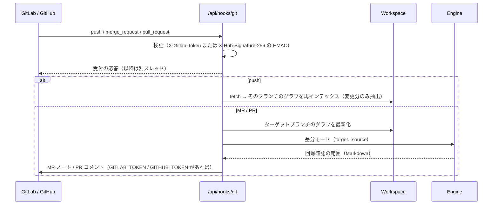

# アーキテクチャ設計書 — himotoki

| 項目 | 内容 |
|---|---|
| 対象 | himotoki v2（`mstkfeb20-collab/himotoki` main） |
| 目的 | 要求（仕様書・チャット）または変更差分から、影響範囲と修正規模を確定させる仕組みの設計を記録する |
| 読者 | 導入・運用を判断する人、ルールパックや抽出器を追加する開発者、連携するエージェントの設計者 |
| 関連 | 使い方・検証結果は [README](../README.md)、脅威と対策・エラー処理の方針は [SECURITY](SECURITY.md)。本書は「なぜこの構成か」と「部品の境界・契約」を扱う |

---

## 1. 背景と要件

### 1.1 解きたい問題

業務システム（SoR）の改修で一番時間がかかり、しかも漏れやすいのが「どこを直すか」の特定です。理由は次の 3 つです。

- **影響が言語・資産をまたぐ。** たとえば次のような経路です。
  - Java の項目
  - → MyBatis の SQL
  - → テーブル・列
  - → 夜間ジョブのシェルと SQL
  - → 連携ファイル
  - → 後続ジョブ
  - → Excel のテーブル定義書・画面項目定義書
- **1 つの業務が複数のサーバにまたがる。** 画面のサーバから SOAP / REST で別サーバを呼び、夜間に CSV を sftp で送り、受信側のファイル監視ジョブが取り込む。DB リンク越しの更新、ストアド内のコミット、EJB のトランザクション属性の違い（REQUIRES_NEW 等）で、どこまでが一緒にロールバックされるかもコードを読まないと分かりません。
- **リポジトリの外に真実がある。** 本番 DB にだけ当てた列・ビュー・ストアド、ジョブスケジューラの定義、Office の設計書、実行時にしか現れない動的 SQL などです。
- **フレームワークが多様で、社内製も多い。** 有名フレームワーク（Spring・MyBatis・Struts・マキネッタ等）に加えて、各社独自の基盤があります。

### 1.2 要件

| # | 要件 | 設計上の対応 |
|---|---|---|
| R1 | 要求文から影響候補を、根拠と確度つきで出す | 解析エンジン（§6）、関係ごとの根拠・確度（§5.3） |
| R2 | Java + Oracle / PostgreSQL、JP1 / cron、Office 設計書を一つの依存グラフにする | 抽出器 7 種（§4.2）と外部ソース取込（§7） |
| R3 | 特定フレームワークに依存しない。社内フレームワークにも追加開発なしで対応する | フレームワーク知識をルールパック（YAML）に外出し（§4.3） |
| R4 | 「これで全数」と言える判断基準を持つ | 全数判定の条件（§6.3）と取込状況レポート（§5.4） |
| R5 | 大規模リポジトリで実用的な時間で更新できる | 内容アドレスの抽出キャッシュ・並列抽出（§4.5）、一括近傍取得（§8） |
| R6 | ソース管理サーバ（git）と連携する。ブランチ単位で扱い、MR/PR で影響を返す | ワークスペース・差分モード・Webhook（§9） |
| R7 | 人が確認・訂正・承認でき、エージェントも同じグラフを使える | ビュワー（REST + WebSocket）・MCP サーバ（§10） |
| R8 | コードを書き換えない（影響範囲と規模の確定までが責務）。確定した範囲は開発へ渡し、実装後の差分で予測を検証する | 出力はグラフ・判断・レポート・作業指示・照合結果のみ（§6.6） |
| R9 | 複数サーバにまたがる業務（SOAP・REST・JMS・DB リンク・ファイル連携）を 1 つの影響範囲として扱い、トランザクション上の注意点を示す | システム単位のグラフ（§4.1）、連携のルール（§4.3）、トランザクション解析（§5.5）、データ連携の伝播（§6.2） |
| R10 | 人の判断と実装の結果から学び、同じシステムの次の解析の精度を上げる | 学習（§6.7） |

### 1.3 スコープ外

- コードの修正・テストの実行（修正工程は Claude Code 等に委ねる。MCP で影響一覧を渡す）
- SVN の直接サポート（git 前提。git-svn によるミラーを想定）
- 手続き内部の制御フロー・データフロー解析（PL/SQL・COBOL の手続き内部など）。PL/SQL は手続き単位の CRUD・呼び出しと、COMMIT・自律型トランザクション・行ロック・ループ内コミットの有無までを扱う
- 実行時のトランザクション構成の判定（XA の参加範囲、例外によるロールバック条件、`@Remote` 越しの伝播）。静的な呼び出し関係からの近似に留める

---

## 2. 設計原則

1. **抽出器は形式を知り、意味はルールが与える。** 抽出器は「Java の構文」「XML の木」「テキストの正規表現」「SQL の CRUD」といった形式だけを扱います。「この XML 要素は SQL 文で、このインターフェースのメソッドに結び付く」といったフレームワークの意味は YAML に書きます。
2. **ファイル単位で閉じた抽出、全体でのリンク。** 抽出結果はファイルごとに独立させ（並列化・キャッシュが効く）、ファイルをまたぐ解決はリンク段で一括して行います。
3. **すべての関係に出所と確からしさを持たせる。** 構文から確定した関係と、名前の一致から推定した関係を区別できないと、人は結果を信用できません。
4. **欠けを隠さない。** 解決できない参照、DB と DDL のずれ、コードに対応の無い実行時 SQL を、グラフ自身が報告します。「全数」の判断材料の一部です。
5. **網羅と絞り込みを分ける。** 機械は候補を広く出し（網羅）、絞り込みは判定（ルール／LLM）と人のレビューで行います。網羅の基準は「定義した探索範囲に未判定が残っていない」こととします。
6. **差し替え可能な境界。** グラフストア（ローカル／Neo4j）、判定（ルール／Claude）、コード検索（git grep／Zoekt／GitLab）はインターフェースの裏に置きます。

---

## 3. 全体構成



### 3.1 モジュール構成

| パッケージ | 責務 | 主なファイル |
|---|---|---|
| `himotoki.model` | ノード種別・関係種別・層の定義 | `model.py` |
| `himotoki.extractors` | 形式ごとの抽出（フレームワーク非依存） | `java.py` `xml.py` `text.py` `sql.py` `props.py` `jobs.py` `docs.py` |
| `himotoki.rules` | ルールパックの読み込み・統合 | `__init__.py`、`*.yaml`（`java-common` `jpa` `mybatis` `spring-xml` `struts1` `web-templates` `jee-remoting` `scripts-jobs` `office` `propagation`） |
| `himotoki.pipeline` | 列挙・分類・抽出の実行・キャッシュ・リンク・トランザクション解析 | `run.py` `facts.py` `cache.py` `linker.py` `resolve_java.py` `transactions.py` |
| `himotoki.sources` | DB 辞書・実行時 SQL・git・コード検索 | `catalog.py` `runtime.py` `git.py` `codesearch.py` |
| `himotoki.store` | グラフストアの抽象と実装 | `base.py` `local.py` `neo4j_store.py` |
| `himotoki.workspace` | 複数グラフ（ref ごと、システム単位）の管理、差分の取得 | `workspace.py` |
| `himotoki.analysis` | 解析エンジン・判定器・規模・Run 保存 | `engine.py` `llm.py` `estimate.py` `search.py` `runstore.py` |
| `himotoki.analysis.knowledge` | 人の判断と照合結果からの学習（`knowledge.db`） | `knowledge.py` |
| `himotoki.settings` / `usage` | AI判定の予算・単価の設定、使用量の台帳 | `settings.py` `usage.py` |
| `himotoki.setup_cmds` | 利用開始の支援: ワークスペースの作成と検出、環境の確認、デモ、`repos/` `docs/` `db/` の一括取り込み | `setup_cmds.py`、`demo/sor-env`（デモ用のサンプル）、`web/`（同梱のビュワー） |
| `himotoki.api` / `cli` / `mcp_server` | 外部インターフェース | |
| `frontend` | ビュワー | `App.tsx` `ListView.tsx` `Graph.tsx` `Inspector.tsx` `Panels.tsx` `ReqAid.tsx` `Tour.tsx` `sizing.ts` |

---

## 4. インデックス

### 4.1 処理の流れ



設計書フォルダ（`--docs`）のファイルはパスに `design:` を付けてリポジトリのファイルと区別し、同じパイプラインに流します。

**システム単位のグラフ**（`index --system NAME --repo A --repo B …`、API の `repos`）では、各リポジトリのファイルに `<リポジトリ名>/` を付けて 1 つの計画にまとめます。リンクはキーで行うため、サーバをまたぐ関係（SOAP のオペレーション、REST のパス、JNDI 名、データファイル名、テーブル、ストアド、DB リンク）も 1 リポジトリ内と同じ仕組みでつながります。エンジンはパスの先頭の名前から読み出し先のリポジトリを決め（`Engine._source_path`）、横断検索は各リポジトリを順に検索します（`MultiSearch`）。差分モードでは変更したリポジトリを指定します（`Workspace.change_hunks`）。ジョブ定義・運用シェルを「設計書フォルダ」側に置いても、同じグラフに入ります。

### 4.2 中間形式 FileFacts

抽出器の出力は、すべて次の共通形式です（`pipeline/facts.py`）。

| 要素 | 内容 | 例 |
|---|---|---|
| node | ファイルに属するノード。`keys` で他から参照される名前を宣言 | `sql:…ReserveRepository.update`（keys: `sql:…ReserveRepository.update`） |
| canonical | ファイルに属さない正準ノード。id で統合される | `table:reserve`、`col:reserve.remarks`、`msg:…lessThanEightyCharsMessage` |
| edge | ファイル内で確定している関係 | クラス → メソッド（CONTAINS） |
| ref | キーへの参照（未解決）。関係種別・確度・行・経由（via）・任意かどうか | `view:reservetour/reserveForm`（RENDERS, conf 0.9, via literal） |
| payload | リンク時に使う補助情報 | Java のクラス・メソッドの記述子（呼び出し・型・フィールドアクセス・ローカル変数） |

「キーへの参照」に留めておくことが、ファイル単位の独立性（並列・キャッシュ）と、言語をまたぐ解決（§5）の両方を成り立たせています。

### 4.3 抽出器とルールパック

| 抽出器 | 形式の処理（コード） | ルールで与える意味（YAML） |
|---|---|---|
| java | tree-sitter で構文解析。クラス・メソッド・フィールド、呼び出し・型・フィールドアクセスの記述子（ループ内か）、文字列リテラル（同一クラスの定数・`+` 連結・テキストブロックを含む） | エンドポイント・DI・テスト・エンティティ・SQL のアノテーション、リテラルを照合する名前空間、インターフェースと外部定義 SQL の結び付け、派生クエリ、`annotation_rules`（アノテーションからキー・属性・参照を作る汎用ルール）、`sql_literals`（SQL らしい文字列を SqlStatement にする）、`transaction_apis` |
| ts | tree-sitter（TypeScript / TSX）で構文解析。モジュール・関数（定数に代入した関数、`memo(...)` などで包んだものを含む）・クラスとメンバー・インターフェースと型のメンバー・enum・定数。本体から呼び出し・JSX のコンポーネント（RENDERS）・型と値の参照・`this.` の呼び出し・`implements`（逆向きの参照で IMPLEMENTED_BY）、Supabase の `.from("表")` に続く操作・`.rpc("関数")`、Prisma の `prisma.モデル.操作()`、`/api/...` の文字列。Next.js App Router の `page`・`route` をエンドポイントにする。テストファイルは `it`/`test` ごとのテストメソッド。CSS クラスなどを除いた文字列・JSX の本文・コメントを本文に入れる。tsconfig.json の `paths` と package.json の `name`・`exports` も読む | （なし。Next.js・Supabase・Prisma の慣習は抽出器が直接読む） |
| prisma | schema.prisma のモデル・項目・`@map`・`@@map`・`///` | （なし） |
| xml | expat で行番号つきの木を作り、ルールを適用（Shift_JIS・EUC-JP の宣言は UTF-8 に読み替える） | `xml:` ルール（対象ファイルの条件、選択パス、ノード・参照・リンクのテンプレート、SQL 本文） |
| text | ファイルの glob に合うルールを適用 | `text:` ルール（正規表現、キーのテンプレート、文脈の保持、SQL として解析する捕捉） |
| sql | sqlglot で CRUD・列を解析（失敗時は正規表現）。文の分割、PL/SQL・PL/pgSQL のブロック（パッケージ本体は手続き単位、文ごとの CRUD、手続き呼び出し、COMMIT・自律型トランザクション・行ロック・ループ内コミット）、`T@LINK` と DB リンクの定義、SQL*Plus のコマンド行と SPOOL、DDL・コメント、DB オブジェクト | 方言 |
| props | properties・YAML のキー。メッセージバンドルの判定 | （なし） |
| jobs | JP1/AJS（ajsprint 形式）のユニット・先行関係・起動コマンド、crontab | （なし。起動されるスクリプトの中身は text ルールが扱う） |
| docs | xlsx・docx・md の表と見出し。表の見出し行の検出、CRUD 表の検出 | `office:` の見出し語彙・CRUD 記号・最低一致数 |

ルールパックの合成（`rules/__init__.py`）:

- 組み込みパック、`HIMOTOKI_RULES` のディレクトリ（`:` 区切り）の順に読み込みます。
- `java:` `office:` `sql:` は辞書として深くマージします（リストは和集合）。`xml:` `text:` `propagation:` はルールを連結します。
- 全パックのバイト列からダイジェストを計算し、キャッシュキーに含めます（§4.5）。

XML ルールの記述要素:

| 要素 | 意味 |
|---|---|
| `when` | 対象ファイルの条件（ルート要素名・ルートの属性・パスの glob） |
| `select` | `/a/b`（ルートから）、`//x`（任意の深さ）、`\|` で複数 |
| `node` | 種別・id・名前・keys・props・親・層・`sql: body`・`sql_skip` |
| `refs` / `links` | 要素からキーへの参照（`props` は関係の属性になる）、キー同士の関係 |
| `where` / `vars` | 属性の条件、ファイルパスから正規表現で取り出す変数 |
| テンプレート | `{@a}` `{/@a}` `{../@a}` `{ancestor::tag@a}` `{>child/path}` `{..>child}` `{ancestor-node}` `{text}` `{file}` `{line}`、代替 `a\|b`、フィルタ `:snake :lower :upper :basename :nocomponent` |

### 4.4 ノードと関係

ノード種別（`model.Kind`）は層ごとに次のとおりです。層はビュワーの同心円と、エンジンの終端判定に使います。

| 層 | 種別 |
|---|---|
| feature | Endpoint, Feature, JobNet, Job, CronEntry, BatchJob |
| code | Class, Method, Field, Template, Script, Bean, SqlMapper, SqlStatement, MessageKey, ConfigFile, XmlElement |
| data | Table, Column, SqlFile, DbObject, DataFile, RuntimeSql |
| test | TestClass, TestMethod |
| doc | DocSection, DocEntity |

ルールのノードは `layer` で層を上書きできます（例: OFBiz の Service を code 層に置く）。

関係種別（`model.Rel`）:

| 分類 | 関係 |
|---|---|
| 構造 | CONTAINS, EXTENDS, IMPLEMENTED_BY |
| コード | CALLS, REFERENCES, INJECTS, CONFIGURES |
| 画面 | HANDLES, RENDERS, BINDS, USES_MESSAGE, INCLUDES |
| データ | MAPS_TO, DEFINES, POPULATES, EXECUTES, READS, WRITES |
| 運用 | RUNS, PRECEDES |
| 証拠 | OBSERVED_AS（実行時 SQL → コード中の SQL）, TESTS, DESCRIBES, DOC_CRUD |

各関係の `props`:

- `src`: parser / rule:<パック名> / catalog / runtime / doc / heuristic
- `conf`: 確度 0〜1
- `via`: 解決経路（literal, mention, derived-query など）
- `line`: 行
- 関係ごとの属性（`ops`、`positional` など）

### 4.5 増分とキャッシュ

| 項目 | 設計 |
|---|---|
| キャッシュキー | (パス, 内容ハッシュ, 抽出器, `抽出器VERSION:抽出器コードのダイジェスト:ルールのダイジェスト`) |
| 内容ハッシュ | git の blob SHA（`git ls-files -s`）。作業ツリーで変更されたファイルは内容から計算 |
| 保存形式 | SQLite（`facts.db`）、FileFacts を zlib 圧縮した JSON |
| 無効化 | ファイルの変更、抽出器コードの変更、ルールの変更のいずれかで自動的に再抽出 |
| 共有 | ワークスペース内の全グラフ（ブランチ・タグ）で共有。同じ blob は一度だけ抽出 |
| リンク | 毎回全体で実行（ファイルをまたぐ関係の一貫性を優先。OFBiz 規模で約 5 秒） |
| 決定性 | FileFacts をパス順に整列してからリンク（実行ごとに関係数が揺れないように） |

---

## 5. リンク

### 5.1 解決の順序

参照（ref）ごとに次の順で解決します（`Linker.resolve_key`）。

1. **キーの完全一致**: いずれかのノードが `keys` で宣言した名前と一致すれば確定します。
2. **名前空間ごとの解決**: キーの接頭辞（`class:` `view:` など）ごとの解決関数に委ねます。
3. **未解決の扱い**:
   - リポジトリに無いパッケージのクラス・メソッドは「外部（ライブラリ）」として数えます。
   - 任意参照（optional。例: 文字列リテラルの試し照合）は黙って捨てます。
   - それ以外は「未解決」として名前空間ごとに数え、例を残します。

| 名前空間 | 解決方法 |
|---|---|
| class / method / field | `JavaResolver`。入れ子・明示 import・同一パッケージ・ワイルドカード・一意な単純名の順に型を解決 |
| propath | `Type.a.b` を、フィールドの型をたどって最後のフィールドへ |
| prop | `form.remarks` / `output.reserve.remarks`。変数名をクラス名に見立て、合わなければ短い接尾辞で再試行 |
| url | メソッド・パステンプレート（`{id}`）を考慮した一致 |
| view | ビュー名の揺れ（接頭辞・拡張子・テンプレートルート） |
| file | パスの接尾辞・ベース名 |
| column / colany | テーブル付き列、別名や候補テーブルからの列 |
| datafile | パスのベース名で同一視。無ければ DataFile ノードを作る（ジョブ間・サーバ間の受け渡しを表現。送信元の `/data/out/orders.csv` と受信先の `/recv/orders.csv` は同じノード） |
| ejbmethod | `ejb-jar.xml` の `<method-name>*</method-name>` をその EJB の全メソッドに展開 |
| mention | 設計書中の語。一意に定まれば確度 0.95、2〜3 件なら確度を分配、それ以上は曖昧として扱わない |
| job / bean / screen / function | 名前の索引 |
| tsexp | TypeScript のモジュールと名前（`web/src/lib/a#fn`）。`a` と `a/index` を試し、無ければ `export *`・`export { x as y } from`・`export * as ns from` をたどる（6 段まで）。`Cls.member` はクラスのメンバーへ。モジュールはあるが名前が無ければモジュールに確度 0.6 |
| tsimp | 相対でない import（`@/lib/x`、`@scope/pkg/sub`）。ワークスペースのパッケージ（package.json の `name` と `exports`、無ければ `src/` 以下）、取り込むファイルに最も近い tsconfig.json の `paths`、どちらも無ければ `@/` を同じパッケージの `src/` とみなす。どれにも当たらなければライブラリ（外部）として数え、未解決にはしない |
| prisma | Prisma のモデル名（大文字小文字を区別しない）→ テーブル |

Java の解決（`resolve_java.py`）は、抽出時に記録した記述子から次のものを再構成します。

- 呼び出しの受け手の型（フィールド・ローカル変数・引数・`this`）とメソッド。インターフェース・抽象メソッドには実装への `IMPLEMENTED_BY` を張ります。
- JPA のエンティティと列の対応
- テストの対象（命名・使用）
- 定数フィールドへのリテラル参照

型推論の範囲は javac の簡易版で、ジェネリクスの推論やラムダの型は追いません（§12）。

ルールや抽出器が参照に付けた属性（`tx_attr`、`dblink`、`via` など。`tables` を除く）は、そのまま関係の属性になります。

### 5.5 トランザクション解析

リンクの最後に `pipeline/transactions.py` がグラフ全体を走査します。フレームワークの知識は持たず、ルールパックと抽出器が付けた属性だけを読みます。

| 入力の属性 | 付ける所 |
|---|---|
| `tx_attr`（メソッド）、`tx_attr_class`・`tx_management`・`ejb`（クラス） | `jee-remoting` のアノテーションルール |
| CONFIGURES 関係の `tx_attr`・`transaction_type` | ejb-jar.xml の XML ルール |
| `tx_calls`（begin / commit / rollback と、ループ内か） | Java 抽出器（`java.transaction_apis` の型への呼び出し） |
| `tx`（commits / rollbacks / autonomous / locks / commit_in_loop / dynamic_sql） | SQL 抽出器（PL/SQL の手続きごと） |
| `remote_call`・`remote_role`、エンドポイントへの参照 | SOAP のアノテーションルール、REST のパスのリテラル |
| WRITES の `dblink`、JNDI 参照の先が MDB | SQL 抽出器、`jndi-resource` ルール |

1. **境界の決定**（`attr`）: ejb-jar.xml → メソッドのアノテーション → Bean 管理（`tx_management: BEAN`）→ クラスのアノテーション → EJB 既定の REQUIRED。REQUIRED / REQUIRES_NEW / NESTED、Bean 管理で begin / commit を呼ぶメソッド、commit を呼ぶメソッド、自分で COMMIT するストアドを境界にします。
2. **範囲の探索**（`scope`）: CALLS / IMPLEMENTED_BY / EXECUTES をたどります。REQUIRES_NEW・NOT_SUPPORTED・NEVER・Bean 管理の呼び出し先は「別トランザクション」として止め、SOAP / REST の呼び出しは「サーバ外」として止めます。テーブルとデータファイルへの READS / WRITES は記録して止めます。
3. **注意点**: 範囲の中で `REMOTE_IN_TX`・`INDEPENDENT_TX`・`PROC_COMMIT_IN_TX`・`DBLINK_WRITE`・`ASYNC_MESSAGE`・`FILE_OUTPUT_IN_TX` を、要素自体の性質として `AUTONOMOUS`・`COMMIT_IN_LOOP`・`LOCK` を記録します。水準（high / medium / low）と日本語の説明を付けます。
4. **書き戻し**: 境界に `tx`（種類・根拠・範囲の要素数・テーブル・リモート呼び出し）と `tx_risks`、注意点が起きた要素にも同じ注意点（`root` 付き）、範囲の要素に `tx_in` を付けます。どの境界にも入らない要素も、自身の性質（行ロックなど）は残します。要約は取込状況の `transactions` です。

エンジンは候補を作るときにこの属性を写し（`tx_risks`・`tx`）、リスト・詳細パネル・レポートに出します。静的な呼び出し関係による近似であり、XA の参加範囲、例外によるロールバック条件、`@Remote` 越しの伝播は判定しません（§12）。

### 5.2 SQL の扱い

SQL は出所が多様です。

- `.sql` ファイル
- Mapper XML の本文
- アノテーション
- シェルの `psql -c` やヒアドキュメント
- 実行時の記録

どこから来ても同じ `crud_refs` で処理し、テーブル・列への READS / WRITES、DDL の DEFINES、列順依存の INSERT の POPULATES（positional）を作ります。PL/SQL・PL/pgSQL の `SELECT … INTO 変数` は変数への代入として扱い、テーブル扱いしません。

### 5.3 根拠と確度

確度は「抽出時の確度 × 解決時の確度」です。

- 抽出時の確度: ルールに書かれた conf、または抽出器の既定値
- 解決時の確度: 名前空間の解決関数が返す値。たとえば一意な型解決は 1.0、曖昧な名前は候補数で割ります。

エンジンは伝播の強さを「伝播ルールの重み × 関係の確度」で計算します（§6.2）。

### 5.4 取込状況（グラフ自身による欠けの報告）

| 報告 | 意味 | 利用 |
|---|---|---|
| unresolved | 名前空間ごとの未解決参照数と例 | ルールパックの不足・命名の揺れの発見 |
| external | ライブラリへの参照数 | 未解決と区別するため |
| drift | DB 辞書と DDL のずれ。DB にだけある列、DDL にだけある列（辞書にあるテーブルに限る）、辞書に無いテーブル | リポジトリ外で当てた改修の発見 |
| runtime | 実行時 SQL のうちコード中の SQL と対応したもの・しないもの（呼び出し回数順の例） | 動的 SQL・他システム・運用ツールといった死角の発見 |
| errors | 抽出エラーの数と例 | |

**設計書の取込確認**（`himotoki/doccheck.py`、CLI `docs-check`、API `/api/docs`・`/api/docs/check`、ビュワーの「取込状況」→「設計書の取込確認」）は、設計書 1 本を取り込みと同じ抽出器でもう一度読み、原本と並べます。AI は使いません。

| 出すもの | 求め方 |
|---|---|
| 表として読んだ表 | 抽出した設計書の項目（DocEntity）を見出し行ごとにまとめ、見出しの各セルを office ルールの語彙（`misc` を含む）でどう読んだかを示す。どの語彙にも無い見出しは「読まない」 |
| 表の外にある文字 | 文字のあるセルのうち、見出し行・読んだ行・CRUD 表の行（列向きの CRUD 表は列）のどれにも入らないもの |
| 見出しらしい行 | 表を 1 つも読めなかったシートで、20 文字以下の文字が 3 つ以上並ぶ行（語彙に足す候補） |
| 読めないもの | パッケージの XML を直接読む。Excel は各シートの描画パーツの図形（`sp`、中の文字も）・画像（`pic`）・グラフ（`graphicFrame`）・線（`cxnSp`）とセルのコメント、結合セルの数。Word は画像・グラフ・テキストボックス（`txbxContent`）と、見出しを認識できなかった表 |
| 結びつき | グラフがあるとき、読んだ行・節から DESCRIBES / DOC_CRUD で結びついた要素。結びつかなかった行は、探した名前（table: / column: など）を添える |
| 要確認 | 上の結果を「表として読めなかったシート」「図形の文字」「表の外が 3 割を超えるシート」「意味の分からない見出し」「結びつかない行」「4,000 文字を超えて途中までしか検索に使っていない節」として文章にし、重要なものから並べる |

実行時 SQL とコード中の SQL の対応付けは、次の条件をすべて満たすものを対応とします。

- 操作（SELECT / INSERT / UPDATE / DELETE）が一致する
- テーブル集合の Jaccard 係数が 0.5 以上
- 両方に列がある場合、列集合の Jaccard 係数が 0.5 以上
- 総合点が 0.6 以上

---

## 6. 解析エンジン

### 6.1 工程



| 工程 | 入力 | 出力 | 差し替え点 |
|---|---|---|---|
| 構造化 | 要求文 | 変更意図（種別: add / modify / delete、語、新しい語、値の変化、変更パターン） | `RuleBasedLLM` / `ClaudeLLM` |
| 起点 | 変更意図 | 起点ノードと理由（語の特異度で重み付け） | `SPEC_*` |
| 伝播 | 起点 | 候補（経路・関係・スコア） | `propagation.yaml` |
| 判定 | 候補と経路 | 判定・確度・理由・変更種別・判定方法（AI／再利用／ルール：低スコア・上限超過） | 判定器、AIの予算（`settings.yaml`・`HIMOTOKI_LLM_*`・解析ごとの指定） |
| 横断検索 | 起点の語（一般的すぎる語は除外） | ヒットした行と要素（新しい候補は上限まで） | `HIMOTOKI_CODESEARCH`、`GREP_*` |
| 独立再探索 | 要求文 | グラフを使わずに見つけた要素 | |
| CRUD | 影響テーブル | 読み書きする全箇所 | |
| 規模 | 確定・未判定の候補 | 人日（確定分＋未判定分の期待値と幅） | `estimate.py` の係数 |

**日本語の語句。** 日本語の要求と英語の識別子の間には、ルールベースでは橋がありません（用語集と設計書の語彙だけ）。そこで要求から語句を切り出し（漢字・カタカナ・英数の連なりと、その漢字・カタカナの部分、「」で囲んだ語。変更を表す語「追加」「修正」などは除く）、要素の本文（画面の文言・コメント・メッセージ・列のコメント）や設計書の節にそのまま出てくるかを調べます（`Engine._phrase_seeds`）。

- 語の重みは特異度 ×（語の長さ／6、上限 1）です。システムに無い語（新しい概念）は分母に入れません。
- 要素ごとに「合った語の重みの和 ÷ 全体」を被覆率とし、0.3 以上（または特異度の高い語が 1 つ合う）で、かつ最良の要素の `PHRASE_REL`（0.34）倍以上のものを、上位 `PHRASE_TOP`（25）件まで起点にします。スコアは 0.35 + 0.5 × 被覆率です。業務全体に出てくる語（「受注」）だけが合う要素は、ここで落ちます。
- 被覆率 0.5 以上の設計書の節は、上位 `PHRASE_DOCS`（5）節まで、その節が説明している（DESCRIBES）コードを起点にします。

**索引の保存。** 類似検索の索引（文字 n-gram の TF-IDF）は、10 万要素規模で作るのに数十秒かかります。グラフファイルの更新時刻・大きさ・要素数を鍵として `search.pkl` に保存し、グラフが変わるまで再利用します。CLI の `index` は取り込みの最後に一度グラフを開き、索引を作っておきます。索引に入れる本文は要素ごとに先頭 1,200 文字までです（語句照合は全文を使う）。解析中のイベントは 0.5 秒ごとにまとめて書き込みます（トランザクションは開いたままにしないので、ビュワー・MCP・CLI が同じ runs.db を使っても待たされない）。

**語の特異度。** 大きなシステムでは loan・note・amount のような語が何千もの識別子に現れ、場所を示す手がかりになりません。そこで、識別子を語に分けて「その語を名前に含む要素の数」を数え、IDF と同じ考え方で 0〜1 の特異度にします（`Engine.specificity`）。数が `SPEC_RARE`（10）以下なら 1、要素全体の `SPEC_COMMON`（2%）以上なら 0 です。境界はシステムの規模に合わせて動くので、小さなシステムでは同じ語が決め手として残ります。

- 起点のスコアに `SPEC_FLOOR + (1 − SPEC_FLOOR) × 特異度` を掛けます（`SPEC_FLOOR` は 0.35）。一般的な語からの起点は弱くなり、伝播が `min_score` で早く止まります。理由欄には特異度を表示します。
- 隣り合う 2〜4 語を連結した名前（「working capital loan」→ `WorkingCapitalLoan`、「mark as fraud」→ `markAsFraud`）も起点にします。連結した名前は、その名前を持つ要素の数で特異度を決めます。
- 横断検索は特異度 `GREP_MIN_SPEC`（0.3）以上の語に限り、最大 `GREP_MAX_TERMS`（12）語までにします。新しい候補は特異度の高い語のヒットから順に `GREP_MAX_NEW`（300）件までとし、スコアにも特異度を掛けます。除外した語と打ち切りの有無は、全数判定の条件 3 の詳細に表示します。
- 画面の部品（`RENDERS`）は両向きにたどります。部品が変われば使う画面に（0.65）、画面が変われば使っている部品に（0.45。一覧に列を足すと行の部品も変わる）。
- テストへの伝播（`TESTS`）の重みは 0.6 です。テストは検証対象の後ろに並び、作業指示では「実行するテスト」として扱います。

### 6.2 伝播

`propagation.yaml` の各行は (関係, 向き, 重み[, 列順依存の重み][, 対象の種別]) です。向きの意味は次のとおりです。

- `in`: その要素に依存しているもの。例: 列を READS している SQL
- `out`: その要素が依存しているもの

主な規則は次のとおりです。

- **段ごとの一括取得**: BFS の各段で、フロンティア全体の近傍をストアに一括で問い合わせます（`neighbors_many` / `get_many`）。
- **スコアの減衰**: スコアは「親のスコア × 重み × 関係の確度」で計算し、`min_score`（既定 0.2）未満は打ち切ります。
- **ハブの抑制**: 被参照が多い要素（ユーティリティ等）からの CALLS / REFERENCES は減衰させます。
- **終端**: 設計書・テスト・SQL ファイル・設定などは終端とし、そこから先へは広げません。ただし SQL ファイルやスクリプトを**起動している**もの（RUNS の逆向き）へは伝えます。列の変更 → 夜間 SQL → シェル → JP1 ジョブ、という経路のためです。
- **ブースト**: 再調査の指示（「設計書と照合して」「DB まで追って」）で、特定の層の重みを上げます。
- **データ連携**: `flow: true` の規則（データファイルの読み手、データファイルを書く要素から書き出し先、`only_in_flow` のファイル監視ジョブから後続ジョブ・起動スクリプト）は、終端の SQL ファイルからも適用し、深さの上限を超えて `flow_depth`（既定 8 段）までたどります。打ち切りは `flow_min_score`（既定 0.1）です。別の経路で先に見つかっていた要素も、データ連携の経路上ならそこから先をたどります。こうして見つかった候補には `data_flow` が付き、ルール判定では「影響低」にせず「要確認」に留めます。出力 SQL → CSV → 送信 → 受信側のファイル監視 → 取り込み、のように 1 つの値がサーバをまたいで運ばれる経路を途中で切らないためです。

### 6.2.1 AI判定の予算

判定は候補数に比例してトークンを使うため、`_judge` は候補を点数の高い順に並べ、次の順で振り分けます（設定は `himotoki/settings.py`、既定値は README の「AIの使用量と設定」）。

1. **再利用**: 再調査で、親の解析でAIが判定済みかつ点数の上昇が `rescore_delta` 未満の候補は、親の判定をそのまま使う。
2. **低スコア**: `min_score` 未満はルール判定。
3. **上限**: その解析でAIに送った件数が `max_items` に達したら、残りはルール判定（`unlimited` で上限なし）。
4. 残りを `batch_size` 件ずつまとめてAIに送る。

候補ごとに `judged_by`（ai / reused / rule:low_score / rule:cap / rule / rule:fallback）を記録します。API 呼び出しごとに、実際の入出力トークン数を `pricing`（settings.yaml）の単価で費用に換算します。結果は解析の `llm_usage` に加算し、`llm.usage` イベントでビュワーに即時に通知し、ワークスペース共通の台帳（`usage.db`）に記録します（`himotoki/usage.py`）。解析ごとの内訳と、API が返した実際の入出力トークン数は `llm_usage` に記録します。横断検索・独立再探索・CRUD確認で見つかった候補は、工程ごとにまとめて判定します。

### 6.3 全数判定の条件

100% の網羅は証明できません。そのため「定義した探索範囲に未判定が残っていない」ことを全数の定義とし、次の条件がすべて満たされたときに承認できるようにしています。

| # | 条件 | 補う盲点 |
|---|---|---|
| 1 | 変更意図ごとに、確定した修正箇所がある | 意図の取りこぼし |
| 2 | 依存の閉包に未判定がない | — |
| 3 | 横断検索のヒットがすべて判定済み | 文字列で書かれた参照・設定・動的呼び出し |
| 4 | 影響テーブルの CRUD 全箇所が判定済み | データ経由の影響 |
| 5 | 独立再探索の結果がすべて判定済み | グラフの欠け |
| 6 | 影響テーブルに触れた実行時 SQL がすべて判定済み（取込時のみ） | リポジトリ外の利用者 |

承認は誰がいつ行ったかを記録します。承認後に判断を変えると承認は外れます。

### 6.4 差分モード



グラフは base 側の時点のものを使います。変更行の位置が base 側のグラフと一致するようにするためです。

### 6.5 Run とイベント

- Run の状態とイベントは SQLite（`runstore.py`）に保存します。
- WebSocket では、過去分のイベントを再生してから新着を流します。
- 再調査は、親の判断を引き継いだ新しい Run として作ります（Run 同士の差分を取れます）。

---

### 6.6 開発への引き渡しと実績との照合

`analysis/handoff.py` が、人が確定した影響範囲を開発（人・コーディングエージェント）へ渡し、実装後の差分で予測を検証します。コードを書き換える機能は持ちません（R8）。



| 処理 | 入力 | 出力 |
|---|---|---|
| `build_handoff` | run の状態（確定・除外・未判定・コメント・トランザクションの注意）とグラフ | ファイルごとの修正対象（理由・コメント・注意・関連する設計書・定義場所・確認すべき呼び出し元・テスト）、DB・連携ファイル・ジョブ、除外、未判定、回帰確認の範囲、エージェントが守る進め方。未承認・未判定ありのときは警告を付ける |
| `handoff_markdown` | 上の結果 | 作業指示書（Markdown）。開発会社への依頼・チケットにもそのまま使う |
| `verify_change` | 作業前後の ref の差分（システム単位では変更したリポジトリ） | 差分の行を含む最小の要素（差分モードと同じ対応付け）を、確定した要素と比べる。包含関係（クラスとそのメソッド等）は一致とみなす。予測漏れは「候補にあったが除外・未確定・影響低」と「候補に無かった」に分ける。前者は判断の見直し、後者はグラフの欠け（ルール・データの追加）を示す。実績の人日があれば補正係数を更新する。結果は run に保存し、ビュワーに通知する |

MCP では `list_runs` → `get_handoff` → 実装 → `verify_change` の順で使います。`get_handoff` の説明文と作業指示の「進め方」に「範囲外の変更が必要なら止まって人に確認する」「除外は変更しない」を明記し、エージェントが範囲を勝手に広げないようにしています。

### 6.7 学習（人の判断と実績から）

`analysis/knowledge.py` が、グラフごと（システムごと）に `knowledge.db` を持ちます。グラフとは別のファイルなので、取り込み直しても消えません。

| 記録するもの | いつ | 内容 |
|---|---|---|
| 判断 | 確定・除外・取り消しのたび（`Engine.decide` / `bulk_decide`） | 要素、たどってきた親と関係、親と要素の種別、変更種別、理由、判断者。再調査は元の解析と同じものとして数える（解析の系列の根を単位にし、最新の判断で上書き） |
| 照合の結果 | 「実績と照合」のたび（`verify_change`） | 当たった予測、予測漏れ（候補にあった／無かった。候補にあった場合は人が判断した要素にも記録）、変更されなかった予測。同じ解析の照合は最新のものだけを使う |
| 学習した関係 | 照合で「候補に無かった」変更があったとき | 解析の起点（確定した起点、なければ上位 3 件の起点）→ 実際に変更された要素 |

解析の開始時にスナップショット（`Learned`）を作り、次のように使います。構造の関係（構文・ルール由来）は書き換えません。

| 学習の単位 | 反映を始める件数 | 解析での効き方 |
|---|---|---|
| 経路の傾向（関係・親の種別・要素の種別） | 5 件の判断 | 伝播の重みに係数（確定率を平滑化して 0.5〜1.4 倍） |
| 個々の経路（親 → 要素） | 2 件 | 同上（0.4〜1.5 倍） |
| 要素の履歴 | 2 回の解析 | 繰り返し除外 ×0.7（理由を表示）、繰り返し確定 ×1.15、実際には変更されたのに除外・未確定 ×1.3、予測したが変更されない ×0.85 |
| 学習した関係 | 1 回の照合 | 起点が候補に入ると、変更された要素を `LEARNED` の関係で候補に加える（重み 0.5〜0.8、回数で増える） |

- 候補には `learned`（種類・係数・説明）が付き、ビュワーと MCP に出ます。AI 判定には `history` として渡し、ルール判定では「実際に変更されたのに漏れた」「学習した関係」の要素を「影響低」にしません。
- 無効化は項目ごと（`ignored` 表）と解析ごと（run の `learning: false`）にできます。人が追加した候補には要素の履歴を適用しません。
- 学習はベストエフォートです。記録に失敗しても判断は失われません。

## 7. 外部ソースの取込

| ソース | 取得方法 | 生成するもの |
|---|---|---|
| PostgreSQL 辞書 | psql で information_schema / pg_catalog を照会（拡張機能のオブジェクトとビューの列は除外） | Table・Column（catalog フラグ・型・コメント）、View・Function・Trigger・Sequence（DbObject）、依存関係、関数本体の CRUD |
| Oracle 辞書 | python-oracledb（thin）で ALL_* を照会、または ALL_TAB_COLUMNS / ALL_TAB_COMMENTS / ALL_COL_COMMENTS / ALL_SOURCE / ALL_DEPENDENCIES の CSV | 同上（パッケージ本体の CRUD を含む） |
| 実行時 SQL | pg_stat_statements、または CSV（V$SQL などのエクスポート）。辞書・監視クエリは除外し、正規化して重複を統合 | RuntimeSql（呼び出し回数・操作・テーブル・列）→ リンク時に OBSERVED_AS |

取り込んだ結果は `<data>/sources/*.json` に FileFacts として保存し、次のインデックスでリポジトリの事実と一緒にリンクします。DB への接続はインデックスと分離しています。本番 DB に毎回つなぐ必要はなく、辞書のエクスポートを渡すだけでも運用できます。

---

## 8. グラフストアと規模

| 項目 | LocalStore | Neo4jStore |
|---|---|---|
| 用途 | 単一マシン・検証・中規模 | 複数グラフの常駐・大規模・他ツールからの照会 |
| 永続化 | `graph.json` | Neo4j（ノードの `uid = <graph>\|<id>` でグラフ名前空間を分離） |
| 一括取得 | メモリ上の索引 | UNWIND による 1 段 1 クエリ |
| 状態 | 検証済み | **実機未検証**（作成環境で Neo4j を起動できなかったため） |

規模の目安（Apache OFBiz、2 CPU、LocalStore）:

| 条件 | 結果・時間 |
|---|---|
| 初回 | 3,515 ファイル → 57,722 ノード・203,503 関係、19.4 秒 |
| 1 ファイル変更 | 11.9 秒。内訳はキャッシュ読込 2.7 秒、リンク 4.9 秒、残りはグラフの書き出し |

これを超える規模（数万ファイル・複数リポジトリ）で想定している方針は次のとおりです（未実装を含みます）。

1. **グラフの単位を選ぶ。** 現在は、1 つの業務を構成するリポジトリ群を 1 つのグラフ（システム単位、§4.1）にまとめ、リポジトリ間の関係をテーブル・URL・SOAP オペレーション・JNDI 名・データファイルといった正準キーで結んでいます（実装済み）。それを超える規模では、システムごとにグラフを分け、システム間を同じ正準キーで結ぶ方針です（未実装）。
2. **リンクを増分化する。** 変更ファイルの参照と、そのキーを提供するノードだけを再解決します。
3. **ストアを Neo4j にする。** グラフ全体をメモリに載せないためです。
4. **抽出キャッシュを共有サーバに置く。** CI とローカルで共用します。

---

## 9. ソース管理サーバとの連携

### 9.1 ワークスペース

```
<HIMOTOKI_DATA_DIR>/
  workspace.json          グラフの一覧（repo・ref・snapshot・docs_dir・commit・件数。システム単位は repos・commits）
  facts.db                抽出キャッシュ（全グラフで共有）
  sources/*.json          DB辞書・実行時SQL
  worktrees/<ref>/        ref ごとの git worktree
  graphs/<repo@ref>/      graph.json・index_stats.json・runs.db
```

### 9.2 Webhook



### 9.3 コード検索

横断検索の実装は `HIMOTOKI_CODESEARCH` で切り替えます。

- 既定: チェックアウト上の `git grep`
- `zoekt:<url>`: Zoekt の JSON API
- `gitlab:<api>:<project id>`: GitLab の blob 検索

サーバ側の検索を使うと、チェックアウトしていないブランチやリポジトリまで横断検索の対象になります。

---

## 10. 利用者インターフェース

| インターフェース | 想定利用者 | 内容 |
|---|---|---|
| ビュワー | 業務分析・開発管理の担当者 | リスト表示（既定。判定の状態ごとの一覧、要素ごとと絞り込み範囲の規模、トランザクション・連携の注意バッジ、キー操作での確定・除外）とグラフ表示（同心円。150 件超ではモジュール単位に集約）の切り替え、根拠と確度・トランザクション境界と注意点の表示、確定・除外・再調査・質問、全数判定、規模、取込状況、差分からの解析、要求の書き方補助（AI不使用）、初回の 1 行ヒントと「?」からの案内、作業の段階と段階ごとの主ボタン、用語の説明、取り込み画面（解析とは別）、AI 使用量と費用（円換算）の即時表示、システム単位のインデックス |
| REST + WebSocket | ビュワー・他システム | 一覧は README の API 節 |
| CLI | 利用者・開発者・CI | demo / init / doctor（利用開始の支援）、index（`--system` で複数リポジトリ。ワークスペースの中では引数なしで一括）/ catalog / runtime / report / analyze / diff（システム単位では `--repo`）/ runs / handoff / verify（開発への引き渡しと照合）/ knowledge（学習）/ serve（`--open`）/ mcp |
| MCP サーバ | Claude Code 等のエージェント | impact_files（最初に使う。ファイル単位の順位と経路を短く返す）, list_graphs, search_elements, get_element（簡潔な形）, neighbors, analyze_requirement, analyze_change（システム単位では repo）, index_gaps（トランザクション解析の要約を含む）、list_runs, get_handoff, verify_change（開発への引き渡しと照合、§6.6）、learned_knowledge（学習、§6.7） |
| Webhook | ソース管理サーバ | §9.2 |

MCP サーバは、エージェントがファイルを丸ごと読まずに「何がこの列を読むか」「この変更はどのジョブに届くか」を構造で問い合わせるための口です。リポジトリの近くで動かせば、コードそのものをネットワークの外に出さずに済みます。

---

## 11. 主な設計判断

| # | 判断 | 採用理由 | 退けた案 |
|---|---|---|---|
| D1 | フレームワーク知識を YAML のルールパックにする | 社内フレームワークへの対応を、コードの変更なしでできる。レビューしやすく差分も小さい。OFBiz をルールだけで取り込めた | フレームワークごとの抽出器（数が増え続ける） |
| D2 | 抽出（ファイル単位）とリンク（全体）を分ける | 並列化と内容アドレスのキャッシュが効く。言語をまたぐ解決を一箇所にまとめられる | 抽出時に他ファイルを参照する（キャッシュが効かない） |
| D3 | LSP（言語サーバ）ではなく自前の抽出＋簡易型解決 | 対象は Java 以外（XML・SQL・JSP・シェル・ジョブ・Office）の比重が大きい。ビルドが通らない古いリポジトリでも動く必要がある | LSP / javac によるフル解析。Java 部分の精度は上がるため、将来、型解決の差し替え点として併用を検討 |
| D4 | すべての関係に src / conf | 推定と確定を区別しないと、人が結果を信用できない。伝播の強さにも使える | 関係の有無だけ |
| D5 | 全数を「探索範囲に未判定なし」と定義 | 網羅の証明は不可能。代わりに確認手順を条件として明示し、監査できるようにする | 確度のしきい値で自動確定 |
| D6 | DB 辞書・実行時 SQL を、インデックスとは別に取り込む | 本番 DB への常時接続を不要にする。エクスポートで運用できる | インデックスのたびに DB へ接続 |
| D7 | 差分は merge-base 基準、グラフは base 側 | MR が見せる差分と一致させる。変更行の位置を base 側のグラフと合わせる | base の先端との単純な差分（他の人の変更が混ざる） |
| D8 | 判定器・ストア・コード検索をインターフェースの裏に置く | API キー無し・Neo4j 無しでも全工程が動く。導入環境に合わせて差し替えられる | |
| D9 | 既定で閉じる（同一オリジン・ローカルのホスト名のみ、公開時はトークン必須、Webhook は署名必須） | ソースコードを返すサーバであり、開発者の手元で動かしたときにブラウザ経由で読まれる経路（CSRF・DNS リバインディング）を塞ぐ必要がある | 全オリジン許可・認証なし（v2 初版。ファイル読み取りの迂回と合わせて実際に悪用できたため改めた） |
| D10 | 複数サーバの業務を 1 つのグラフにする（ファイルに `<リポジトリ名>/` を付ける） | リンクがキーで行われるため、SOAP・REST・JMS・DB リンク・連携ファイルがサーバをまたいでも追加の仕組み無しでつながる。影響分析と全数判定を業務単位で行える | リポジトリごとのグラフをあとから突き合わせる（伝播が境界で切れる） |
| D11 | トランザクション解析は、ルールと抽出器が付けた属性だけを読む汎用処理にする | EJB・Spring・Bean 管理・PL/SQL を同じ規則で扱え、別の基盤もルールの追加で対応できる。結果は判定ではなく「確認すべき場所」として示す | フレームワークごとの専用解析、実行時トレースによる確定 |
| D12 | データ連携だけは探索の深さの上限を超えてたどる（`flow` 指定の関係のみ） | 出力 SQL → ファイル → 送信 → 受信 → 取り込みは段数が多く、深さ 3 では途中で切れる。対象を連携の関係に限ることで候補の膨張を抑える（ツアー予約の例で +1 件） | 深さ全体を上げる（候補が一律に増える） |
| D13 | ビュワーをビルド済みで Python パッケージに同梱し、ワークスペースのフォルダ構成を決める | 利用者は Python と Git だけで始められ、置き場所に迷わない。社内ネットワークで npm が通らない環境でも使える。同梱分とソースのずれはテストで検出する | 利用者が Node.js でビルドする、置き場所を毎回コマンドで指定する |
| D14 | 修正はせず、作業指示を渡して実装後の差分で検証する | 修正はエージェントや開発会社の方が得意で、責任分界もはっきりする。照合の結果を「判断の見直し」と「グラフの欠け」に分けて戻すと、次の解析の精度が上がる | このツールで修正案（パッチ）まで作る |
| D15 | 学習はグラフとは別の層に置き、少ない件数では効かせない | 構文から確定した関係を人の判断で書き換えると根拠が追えなくなる。1 回の除外で次から出なくなると、漏れが増える方向に壊れる。根拠と件数を残し、項目ごとに無効化できるようにする | 判断を直接グラフの関係の確度に書き込む、機械学習モデルを学習させる（件数が少なく説明できない） |
| D16 | TypeScript は型推論をせず、import と名前でつなぐ。日本語の要求は、コード中の日本語（画面の文言・コメント）と語句で照合する | ビルドや依存の導入なしに数秒で取り込める。日本語の業務システムでは画面の文言が要求と同じ言葉で書かれていることが多く、英語の識別子への翻訳より確実 | TypeScript コンパイラ（tsc / LSP）による型解決（Node.js と依存の導入が必要）、日本語→英語の機械翻訳で識別子を推測する |

---

## 12. 制約とリスク

| 項目 | 内容 | 対策・方針 |
|---|---|---|
| 実機未検証 | Neo4j ストア、Docker 構成、Oracle への直接接続、Zoekt / GitLab のコード検索、MR/PR へのコメント投稿、Claude 判定 | 導入時に実機で確認する。インターフェースはローカル実装と共通 |
| 型解決の精度 | ジェネリクスの推論・ラムダ・リフレクションは追わない | 横断検索・独立再探索で補う。将来は LSP / javac を差し替え点として併用 |
| トランザクション解析の精度 | 静的な呼び出し関係による近似。XA の参加範囲、例外によるロールバック条件、`@Remote` 越しの伝播、接続先 URL を設定から組み立てる REST は判定しない | 注意点は「確認すべき場所」の提示に留め、判断はレビューで行う |
| 設計書の形式 | 見出し行を語彙で探す方式のため、結合セルの多い帳票型・図からは取り出せない | `office:` の語彙を現場の書式に合わせて追加する |
| ルールベース判定の絞り込み | 網羅は高いが、「影響あり」の適合率は低い | Claude 判定、またはビュワーでのレビューを前提にする |
| リンクが全体実行 | 変更が 1 ファイルでもリンクは全体 | §8 の増分リンク |
| 評価の独立性 | 検証用の周辺資産と正解は同じ作り手が用意した | 実案件で、有識者が作った正解と突き合わせて評価する |

---

## 13. 拡張の手順

| やりたいこと | 手順 |
|---|---|
| 社内フレームワーク・新しい XML 形式に対応する | `HIMOTOKI_RULES` のディレクトリに YAML を追加し、`himotoki report` で未解決参照が減ることを確認する |
| 新しいテキスト形式（テンプレート言語・スクリプト）に対応する | `text:` ルールを追加する（glob・正規表現・キー） |
| 設計書の書式に合わせる | `office:` の `headers` に見出し語を追加する |
| 伝播の強さを調整する | `propagation.yaml` の重みを変える（コードの変更は不要） |
| 新しい形式そのもの（例: COBOL）を扱う | `extractors/` に `NAME` `VERSION` `extract(path, data, rules) -> FileFacts` を持つモジュールを追加し、`run.classify` に登録する。リンクはキーで行われるため、他は変更不要 |
| 新しい名前空間の解決を追加する | `Linker` に `_ns_<名前空間>(value, props) -> [(node_id, conf)]` を追加する |
| 判定・ストア・検索を差し替える | `analysis/llm.py`・`store/base.py`・`sources/codesearch.py` のインターフェースを実装する |

---

## 付録 A. 設定（環境変数）

| 変数 | 用途 |
|---|---|
| `HIMOTOKI_DATA_DIR` | ワークスペースの場所 |
| `HIMOTOKI_RULES` | 追加ルールパックのディレクトリ（`:` 区切り） |
| `HIMOTOKI_STORE`、`NEO4J_URI` / `NEO4J_USER` / `NEO4J_PASSWORD` / `NEO4J_DATABASE` | グラフストアの選択と接続 |
| `ANTHROPIC_API_KEY`、`HIMOTOKI_LLM_MODEL` | Claude 判定（無ければルールベース） |
| `HIMOTOKI_CODESEARCH` | 横断検索の実装 |
| `HIMOTOKI_WEBHOOK_SECRET` | Webhook の検証 |
| `GITLAB_API` / `GITLAB_TOKEN`、`GITHUB_API` / `GITHUB_TOKEN` | MR / PR へのコメント、GitLab コード検索 |
| `HIMOTOKI_FRONTEND` | 配信するビュワーのビルド先 |
| `HIMOTOKI_SETTINGS`、`HIMOTOKI_LLM_MIN_SCORE` / `MAX_ITEMS` / `REUSE_VERDICTS` / `RESCORE_DELTA` / `BATCH_SIZE` | 設定ファイルの場所と、AI判定の予算（§6.2.1） |
| `HIMOTOKI_JPY_PER_USD`、`HIMOTOKI_PRICE_INPUT` / `HIMOTOKI_PRICE_OUTPUT` | 費用表示の為替レートと単価（既定は settings.yaml の `pricing`） |
| `HIMOTOKI_API_TOKEN`、`HIMOTOKI_ALLOWED_HOSTS`、`HIMOTOKI_CORS_ORIGINS` | API の認証・許可するホスト名・CORS（[SECURITY](SECURITY.md)） |
| `HIMOTOKI_ALLOWED_ROOTS`、`HIMOTOKI_ALLOW_DB_FROM_API` | API で指定できるパスの範囲、API からの DB 接続の許可 |
| `HIMOTOKI_MAX_FILE_MB`、`HIMOTOKI_MAX_OFFICE_MB`、`HIMOTOKI_GIT_TIMEOUT`、`HIMOTOKI_LLM_TIMEOUT` | 資源の上限・タイムアウト |

## 付録 B. 検証の対応表

| 設計要素 | 検証 |
|---|---|
| ルールパックによる社内フレームワーク対応 | `tests/test_mechanism.py::test_rule_pack_links_java_to_xml_sql_to_tables`、OFBiz の取込 |
| ジョブ・スクリプト・データファイルの連鎖 | `test_jobs_scripts_and_data_files_chain`、ツアー予約の JP1 定義 |
| サーバ間連携・システム単位のグラフ・トランザクション解析・データ連携の伝播 | `tests/test_sor_system.py`（`backend/himotoki/demo/sor-env` の 3 リポジトリ） |
| Office の見出し検出・CRUD 表 | `test_office_header_detection_and_crud_matrix` |
| DB 辞書のずれ・実行時 SQL の対応 | `test_catalog_drift_and_runtime_matching`、PostgreSQL 16 実機、Oracle 辞書の CSV |
| 抽出キャッシュの増分 | `test_fact_cache_reextracts_only_changed_files`、OFBiz の 1 ファイル変更 |
| 差分モード・Webhook | `test_diff_mode_regression_scope`、`test_webhook_payloads`、GitLab MR イベントによる通しの確認 |
| 開発への引き渡しと照合 | `tests/test_handoff.py` |
| 学習 | `tests/test_learning.py` |
| MCP | stdio の実クライアントから 7 ツールを呼び出し |
| 要求からの解析 | ツアー予約「備考 80→200 文字」（正解 18/18 が候補）、コミット履歴 25 件、PetClinic 3 要求 |
