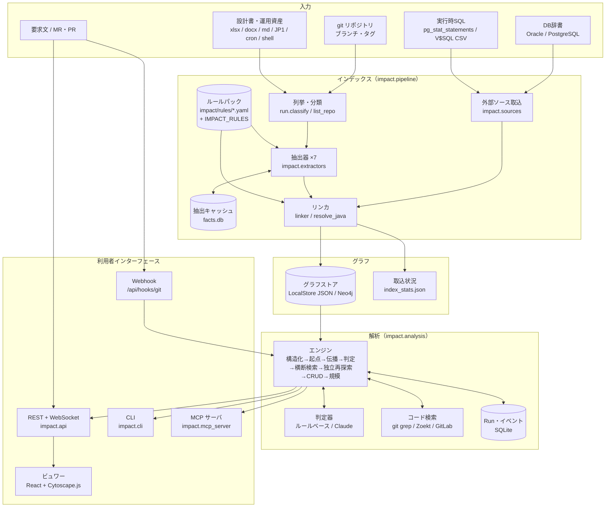
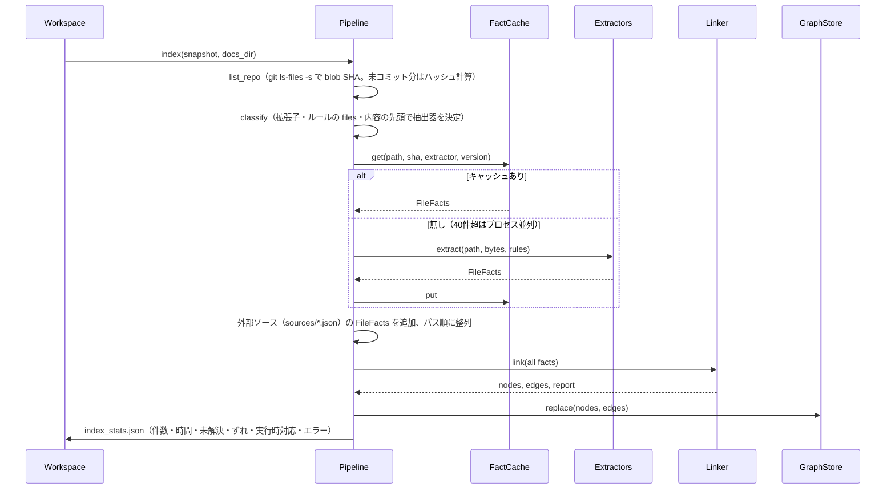
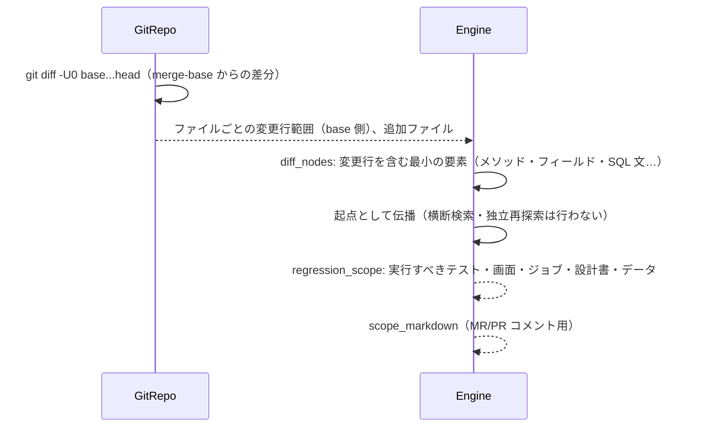
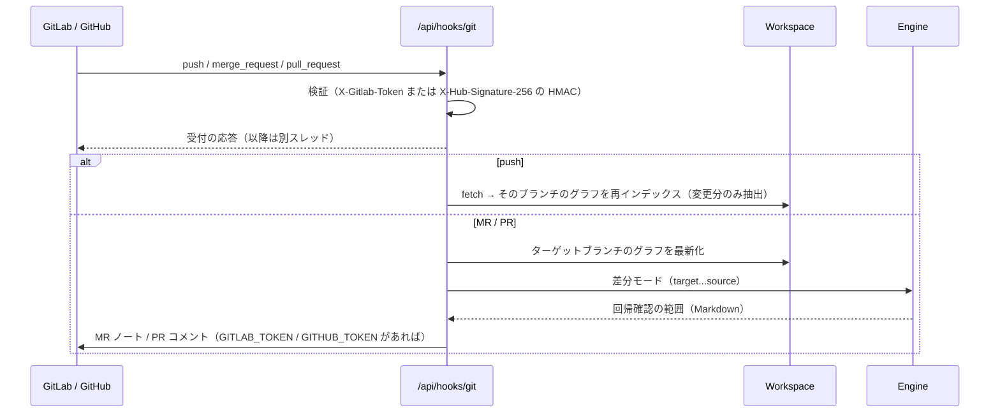

# アーキテクチャ設計書 — Impact Analyzer

| 項目 | 内容 |
|---|---|
| 対象 | Impact Analyzer v2（`mstkfeb20-collab/codegraph` main） |
| 目的 | 要求（仕様書・チャット）または変更差分から、影響範囲と修整規模を確定させる仕組みの設計を記録する |
| 読者 | 導入・運用を判断する人、ルールパックや抽出器を追加する開発者、連携するエージェントの設計者 |
| 関連 | 使い方・検証結果は [README](../README.md)、脅威と対策・エラー処理の方針は [SECURITY](SECURITY.md)。本書は「なぜこの構成か」と「部品の境界・契約」を扱う |

---

## 1. 背景と要件

### 1.1 解きたい問題

業務システム（SoR）の改修で一番時間がかかり、しかも漏れやすいのが「どこを直すか」の特定です。理由は次の 3 つです。

- **影響が言語・資産をまたぐ。** たとえば次のような経路です。
  - Java の項目
  - → MyBatis の SQL
  - → テーブル・列
  - → 夜間ジョブのシェルと SQL
  - → 連携ファイル
  - → 後続ジョブ
  - → Excel のテーブル定義書・画面項目定義書
- **リポジトリの外に真実がある。** 本番 DB にだけ当てた列・ビュー・ストアド、ジョブスケジューラの定義、Office の設計書、実行時にしか現れない動的 SQL などです。
- **フレームワークが多様で、社内製も多い。** 有名フレームワーク（Spring・MyBatis・Struts・マキネッタ等）に加えて、各社独自の基盤があります。

### 1.2 要件

| # | 要件 | 設計上の対応 |
|---|---|---|
| R1 | 要求文から影響候補を、根拠と確度つきで出す | 解析エンジン（§6）、関係ごとの根拠・確度（§5.3） |
| R2 | Java + Oracle / PostgreSQL、JP1 / cron、Office 設計書を一つの依存グラフにする | 抽出器 7 種（§4.2）と外部ソース取込（§7） |
| R3 | 特定フレームワークに依存しない。社内フレームワークにも追加開発なしで対応する | フレームワーク知識をルールパック（YAML）に外出し（§4.3） |
| R4 | 「これで全数」と言える判断基準を持つ | 全数判定の条件（§6.3）と取込状況レポート（§5.4） |
| R5 | 大規模リポジトリで実用的な時間で更新できる | 内容アドレスの抽出キャッシュ・並列抽出（§4.5）、一括近傍取得（§8） |
| R6 | ソース管理サーバ（git）と連携する。ブランチ単位で扱い、MR/PR で影響を返す | ワークスペース・差分モード・Webhook（§9） |
| R7 | 人が確認・訂正・承認でき、エージェントも同じグラフを使える | ビュワー（REST + WebSocket）・MCP サーバ（§10） |
| R8 | コードを書き換えない（影響範囲と規模の確定までが責務） | 出力はグラフ・判断・レポートのみ |

### 1.3 スコープ外

- コードの修整・テストの実行（修整工程は Claude Code 等に委ねる。MCP で影響一覧を渡す）
- SVN の直接サポート（git 前提。git-svn によるミラーを想定）
- 手続き内部の制御フロー・データフロー解析（PL/SQL・COBOL の手続き内部など）

---

## 2. 設計原則

1. **抽出器は形式を知り、意味はルールが与える。** 抽出器は「Java の構文」「XML の木」「テキストの正規表現」「SQL の CRUD」といった形式だけを扱います。「この XML 要素は SQL 文で、このインターフェースのメソッドに結び付く」といったフレームワークの意味は YAML に書きます。
2. **ファイル単位で閉じた抽出、全体でのリンク。** 抽出結果はファイルごとに独立させ（並列化・キャッシュが効く）、ファイルをまたぐ解決はリンク段で一括して行います。
3. **すべての関係に出所と確からしさを持たせる。** 構文から確定した関係と、名前の一致から推定した関係を区別できないと、人は結果を信用できません。
4. **欠けを隠さない。** 解決できない参照、DB と DDL のずれ、コードに対応の無い実行時 SQL を、グラフ自身が報告します。「全数」の判断材料の一部です。
5. **網羅と絞り込みを分ける。** 機械は候補を広く出し（網羅）、絞り込みは判定（ルール／LLM）と人のレビューで行います。網羅の基準は「定義した探索範囲に未判定が残っていない」こととします。
6. **差し替え可能な境界。** グラフストア（ローカル／Neo4j）、判定（ルール／Claude）、コード検索（git grep／Zoekt／GitLab）はインターフェースの裏に置きます。

---

## 3. 全体構成



### 3.1 モジュール構成

| パッケージ | 責務 | 主なファイル |
|---|---|---|
| `impact.model` | ノード種別・関係種別・層の定義 | `model.py` |
| `impact.extractors` | 形式ごとの抽出（フレームワーク非依存） | `java.py` `xml.py` `text.py` `sql.py` `props.py` `jobs.py` `docs.py` |
| `impact.rules` | ルールパックの読み込み・統合 | `__init__.py`、`*.yaml` |
| `impact.pipeline` | 列挙・分類・抽出の実行・キャッシュ・リンク | `run.py` `facts.py` `cache.py` `linker.py` `resolve_java.py` |
| `impact.sources` | DB 辞書・実行時 SQL・git・コード検索 | `catalog.py` `runtime.py` `git.py` `codesearch.py` |
| `impact.store` | グラフストアの抽象と実装 | `base.py` `local.py` `neo4j_store.py` |
| `impact.workspace` | 複数グラフ（ref ごと）の管理 | `workspace.py` |
| `impact.analysis` | 解析エンジン・判定器・規模・Run 保存 | `engine.py` `llm.py` `estimate.py` `search.py` `runstore.py` |
| `impact.api` / `cli` / `mcp_server` | 外部インターフェース | |
| `frontend` | ビュワー | `App.tsx` `Graph.tsx` `Inspector.tsx` `Panels.tsx` |

---

## 4. インデックス

### 4.1 処理の流れ



設計書フォルダ（`--docs`）のファイルはパスに `design:` を付けてリポジトリのファイルと区別し、同じパイプラインに流します。ジョブ定義・運用シェルを「設計書フォルダ」側に置いても、同じグラフに入ります。

### 4.2 中間形式 FileFacts

抽出器の出力は、すべて次の共通形式です（`pipeline/facts.py`）。

| 要素 | 内容 | 例 |
|---|---|---|
| node | ファイルに属するノード。`keys` で他から参照される名前を宣言 | `sql:…ReserveRepository.update`（keys: `sql:…ReserveRepository.update`） |
| canonical | ファイルに属さない正準ノード。id で統合される | `table:reserve`、`col:reserve.remarks`、`msg:…lessThanEightyCharsMessage` |
| edge | ファイル内で確定している関係 | クラス → メソッド（CONTAINS） |
| ref | キーへの参照（未解決）。関係種別・確度・行・経由（via）・任意かどうか | `view:reservetour/reserveForm`（RENDERS, conf 0.9, via literal） |
| payload | リンク時に使う補助情報 | Java のクラス・メソッドの記述子（呼び出し・型・フィールドアクセス・ローカル変数） |

「キーへの参照」に留めておくことが、ファイル単位の独立性（並列・キャッシュ）と、言語をまたぐ解決（§5）の両方を成り立たせています。

### 4.3 抽出器とルールパック

| 抽出器 | 形式の処理（コード） | ルールで与える意味（YAML） |
|---|---|---|
| java | tree-sitter で構文解析。クラス・メソッド・フィールド、呼び出し・型・フィールドアクセスの記述子、文字列リテラル（同一クラスの定数経由を含む） | エンドポイント・DI・テスト・エンティティ・SQL のアノテーション、リテラルを照合する名前空間、インターフェースと外部定義 SQL の結び付け、派生クエリ |
| xml | expat で行番号つきの木を作り、ルールを適用 | `xml:` ルール（対象ファイルの条件、選択パス、ノード・参照・リンクのテンプレート、SQL 本文） |
| text | ファイルの glob に合うルールを適用 | `text:` ルール（正規表現、キーのテンプレート、文脈の保持、SQL として解析する捕捉） |
| sql | sqlglot で CRUD・列を解析（失敗時は正規表現）。文の分割、PL/SQL・PL/pgSQL のブロック、DDL・コメント、DB オブジェクト | 方言 |
| props | properties・YAML のキー。メッセージバンドルの判定 | （なし） |
| jobs | JP1/AJS（ajsprint 形式）のユニット・先行関係・起動コマンド、crontab | （なし。起動されるスクリプトの中身は text ルールが扱う） |
| docs | xlsx・docx・md の表と見出し。表の見出し行の検出、CRUD 表の検出 | `office:` の見出し語彙・CRUD 記号・最低一致数 |

ルールパックの合成（`rules/__init__.py`）:

- 組み込みパック、`IMPACT_RULES` のディレクトリ（`:` 区切り）の順に読み込みます。
- `java:` `office:` `sql:` は辞書として深くマージします（リストは和集合）。`xml:` `text:` `propagation:` はルールを連結します。
- 全パックのバイト列からダイジェストを計算し、キャッシュキーに含めます（§4.5）。

XML ルールの記述要素:

| 要素 | 意味 |
|---|---|
| `when` | 対象ファイルの条件（ルート要素名・ルートの属性・パスの glob） |
| `select` | `/a/b`（ルートから）、`//x`（任意の深さ）、`\|` で複数 |
| `node` | 種別・id・名前・keys・親・層・`sql: body`・`sql_skip` |
| `refs` / `links` | 要素からキーへの参照、キー同士の関係 |
| `where` / `vars` | 属性の条件、ファイルパスから正規表現で取り出す変数 |
| テンプレート | `{@a}` `{/@a}` `{../@a}` `{ancestor::tag@a}` `{ancestor-node}` `{text}` `{file}` `{line}`、代替 `a\|b`、フィルタ `:snake :lower :upper :basename :nocomponent` |

### 4.4 ノードと関係

ノード種別（`model.Kind`）は層ごとに次のとおりです。層はビュワーの同心円と、エンジンの終端判定に使います。

| 層 | 種別 |
|---|---|
| feature | Endpoint, Feature, JobNet, Job, CronEntry, BatchJob |
| code | Class, Method, Field, Template, Script, Bean, SqlMapper, SqlStatement, MessageKey, ConfigFile, XmlElement |
| data | Table, Column, SqlFile, DbObject, DataFile, RuntimeSql |
| test | TestClass, TestMethod |
| doc | DocSection, DocEntity |

ルールのノードは `layer` で層を上書きできます（例: OFBiz の Service を code 層に置く）。

関係種別（`model.Rel`）:

| 分類 | 関係 |
|---|---|
| 構造 | CONTAINS, EXTENDS, IMPLEMENTED_BY |
| コード | CALLS, REFERENCES, INJECTS, CONFIGURES |
| 画面 | HANDLES, RENDERS, BINDS, USES_MESSAGE, INCLUDES |
| データ | MAPS_TO, DEFINES, POPULATES, EXECUTES, READS, WRITES |
| 運用 | RUNS, PRECEDES |
| 証拠 | OBSERVED_AS（実行時 SQL → コード中の SQL）, TESTS, DESCRIBES, DOC_CRUD |

各関係の `props`:

- `src`: parser / rule:<パック名> / catalog / runtime / doc / heuristic
- `conf`: 確度 0〜1
- `via`: 解決経路（literal, mention, derived-query など）
- `line`: 行
- 関係ごとの属性（`ops`、`positional` など）

### 4.5 増分とキャッシュ

| 項目 | 設計 |
|---|---|
| キャッシュキー | (パス, 内容ハッシュ, 抽出器, `抽出器VERSION:抽出器コードのダイジェスト:ルールのダイジェスト`) |
| 内容ハッシュ | git の blob SHA（`git ls-files -s`）。作業ツリーで変更されたファイルは内容から計算 |
| 保存形式 | SQLite（`facts.db`）、FileFacts を zlib 圧縮した JSON |
| 無効化 | ファイルの変更、抽出器コードの変更、ルールの変更のいずれかで自動的に再抽出 |
| 共有 | ワークスペース内の全グラフ（ブランチ・タグ）で共有。同じ blob は一度だけ抽出 |
| リンク | 毎回全体で実行（ファイルをまたぐ関係の一貫性を優先。OFBiz 規模で約 5 秒） |
| 決定性 | FileFacts をパス順に整列してからリンク（実行ごとに関係数が揺れないように） |

---

## 5. リンク

### 5.1 解決の順序

参照（ref）ごとに次の順で解決します（`Linker.resolve_key`）。

1. **キーの完全一致**: いずれかのノードが `keys` で宣言した名前と一致すれば確定します。
2. **名前空間ごとの解決**: キーの接頭辞（`class:` `view:` など）ごとの解決関数に委ねます。
3. **未解決の扱い**:
   - リポジトリに無いパッケージのクラス・メソッドは「外部（ライブラリ）」として数えます。
   - 任意参照（optional。例: 文字列リテラルの試し照合）は黙って捨てます。
   - それ以外は「未解決」として名前空間ごとに数え、例を残します。

| 名前空間 | 解決方法 |
|---|---|
| class / method / field | `JavaResolver`。入れ子・明示 import・同一パッケージ・ワイルドカード・一意な単純名の順に型を解決 |
| propath | `Type.a.b` を、フィールドの型をたどって最後のフィールドへ |
| prop | `form.remarks` / `output.reserve.remarks`。変数名をクラス名に見立て、合わなければ短い接尾辞で再試行 |
| url | メソッド・パステンプレート（`{id}`）を考慮した一致 |
| view | ビュー名の揺れ（接頭辞・拡張子・テンプレートルート） |
| file | パスの接尾辞・ベース名 |
| column / colany | テーブル付き列、別名や候補テーブルからの列 |
| datafile | パスのベース名で同一視。無ければ DataFile ノードを作る（ジョブ間の受け渡しを表現） |
| mention | 設計書中の語。一意に定まれば確度 0.95、2〜3 件なら確度を分配、それ以上は曖昧として扱わない |
| job / bean / screen / function | 名前の索引 |

Java の解決（`resolve_java.py`）は、抽出時に記録した記述子から次のものを再構成します。

- 呼び出しの受け手の型（フィールド・ローカル変数・引数・`this`）とメソッド。インターフェース・抽象メソッドには実装への `IMPLEMENTED_BY` を張ります。
- JPA のエンティティと列の対応
- テストの対象（命名・使用）
- 定数フィールドへのリテラル参照

型推論の範囲は javac の簡易版で、ジェネリクスの推論やラムダの型は追いません（§12）。

### 5.2 SQL の扱い

SQL は出所が多様です。

- `.sql` ファイル
- Mapper XML の本文
- アノテーション
- シェルの `psql -c` やヒアドキュメント
- 実行時の記録

どこから来ても同じ `crud_refs` で処理し、テーブル・列への READS / WRITES、DDL の DEFINES、列順依存の INSERT の POPULATES（positional）を作ります。PL/SQL・PL/pgSQL の `SELECT … INTO 変数` は変数への代入として扱い、テーブル扱いしません。

### 5.3 根拠と確度

確度は「抽出時の確度 × 解決時の確度」です。

- 抽出時の確度: ルールに書かれた conf、または抽出器の既定値
- 解決時の確度: 名前空間の解決関数が返す値。たとえば一意な型解決は 1.0、曖昧な名前は候補数で割ります。

エンジンは伝播の強さを「伝播ルールの重み × 関係の確度」で計算します（§6.2）。

### 5.4 取込状況（グラフ自身による欠けの報告）

| 報告 | 意味 | 利用 |
|---|---|---|
| unresolved | 名前空間ごとの未解決参照数と例 | ルールパックの不足・命名の揺れの発見 |
| external | ライブラリへの参照数 | 未解決と区別するため |
| drift | DB 辞書と DDL のずれ。DB にだけある列、DDL にだけある列（辞書にあるテーブルに限る）、辞書に無いテーブル | リポジトリ外で当てた改修の発見 |
| runtime | 実行時 SQL のうちコード中の SQL と対応したもの・しないもの（呼び出し回数順の例） | 動的 SQL・他システム・運用ツールといった死角の発見 |
| errors | 抽出エラーの数と例 | |

実行時 SQL とコード中の SQL の対応付けは、次の条件をすべて満たすものを対応とします。

- 操作（SELECT / INSERT / UPDATE / DELETE）が一致する
- テーブル集合の Jaccard 係数が 0.5 以上
- 両方に列がある場合、列集合の Jaccard 係数が 0.5 以上
- 総合点が 0.6 以上

---

## 6. 解析エンジン

### 6.1 工程


| 工程 | 入力 | 出力 | 差し替え点 |
|---|---|---|---|
| 構造化 | 要求文 | 変更意図（種別: add / modify / delete、語、新しい語、値の変化、変更パターン） | `RuleBasedLLM` / `ClaudeLLM` |
| 起点 | 変更意図 | 起点ノードと理由 | |
| 伝播 | 起点 | 候補（経路・関係・スコア） | `propagation.yaml` |
| 判定 | 候補と経路 | 判定・確度・理由・変更種別 | 判定器 |
| 横断検索 | 起点の語 | ヒットした行と要素 | `IMPACT_CODESEARCH` |
| 独立再探索 | 要求文 | グラフを使わずに見つけた要素 | |
| CRUD | 影響テーブル | 読み書きする全箇所 | |
| 規模 | 確定・未判定の候補 | 人日（確定分＋未判定分の期待値と幅） | `estimate.py` の係数 |

### 6.2 伝播

`propagation.yaml` の各行は (関係, 向き, 重み[, 列順依存の重み][, 対象の種別]) です。向きの意味は次のとおりです。

- `in`: その要素に依存しているもの。例: 列を READS している SQL
- `out`: その要素が依存しているもの

主な規則は次のとおりです。

- **段ごとの一括取得**: BFS の各段で、フロンティア全体の近傍をストアに一括で問い合わせます（`neighbors_many` / `get_many`）。
- **スコアの減衰**: スコアは「親のスコア × 重み × 関係の確度」で計算し、`min_score`（既定 0.2）未満は打ち切ります。
- **ハブの抑制**: 被参照が多い要素（ユーティリティ等）からの CALLS / REFERENCES は減衰させます。
- **終端**: 設計書・テスト・SQL ファイル・設定などは終端とし、そこから先へは広げません。ただし SQL ファイルやスクリプトを**起動している**もの（RUNS の逆向き）へは伝えます。列の変更 → 夜間 SQL → シェル → JP1 ジョブ、という経路のためです。
- **ブースト**: 再調査の指示（「設計書と照合して」「DB まで追って」）で、特定の層の重みを上げます。

### 6.3 全数判定の条件

100% の網羅は証明できません。そのため「定義した探索範囲に未判定が残っていない」ことを全数の定義とし、次の条件がすべて満たされたときに承認できるようにしています。

| # | 条件 | 補う盲点 |
|---|---|---|
| 1 | 変更意図ごとに、確定した修正箇所がある | 意図の取りこぼし |
| 2 | 依存の閉包に未判定がない | — |
| 3 | 横断検索のヒットがすべて判定済み | 文字列で書かれた参照・設定・動的呼び出し |
| 4 | 影響テーブルの CRUD 全箇所が判定済み | データ経由の影響 |
| 5 | 独立再探索の結果がすべて判定済み | グラフの欠け |
| 6 | 影響テーブルに触れた実行時 SQL がすべて判定済み（取込時のみ） | リポジトリ外の利用者 |

承認は誰がいつ行ったかを記録します。承認後に判断を変えると承認は外れます。

### 6.4 差分モード



グラフは base 側の時点のものを使います。変更行の位置が base 側のグラフと一致するようにするためです。

### 6.5 Run とイベント

- Run の状態とイベントは SQLite（`runstore.py`）に保存します。
- WebSocket では、過去分のイベントを再生してから新着を流します。
- 再調査は、親の判断を引き継いだ新しい Run として作ります（Run 同士の差分を取れます）。

---

## 7. 外部ソースの取込

| ソース | 取得方法 | 生成するもの |
|---|---|---|
| PostgreSQL 辞書 | psql で information_schema / pg_catalog を照会（拡張機能のオブジェクトとビューの列は除外） | Table・Column（catalog フラグ・型・コメント）、View・Function・Trigger・Sequence（DbObject）、依存関係、関数本体の CRUD |
| Oracle 辞書 | python-oracledb（thin）で ALL_* を照会、または ALL_TAB_COLUMNS / ALL_TAB_COMMENTS / ALL_COL_COMMENTS / ALL_SOURCE / ALL_DEPENDENCIES の CSV | 同上（パッケージ本体の CRUD を含む） |
| 実行時 SQL | pg_stat_statements、または CSV（V$SQL などのエクスポート）。辞書・監視クエリは除外し、正規化して重複を統合 | RuntimeSql（呼び出し回数・操作・テーブル・列）→ リンク時に OBSERVED_AS |

取り込んだ結果は `<data>/sources/*.json` に FileFacts として保存し、次のインデックスでリポジトリの事実と一緒にリンクします。DB への接続はインデックスと分離しています。本番 DB に毎回つなぐ必要はなく、辞書のエクスポートを渡すだけでも運用できます。

---

## 8. グラフストアと規模

| 項目 | LocalStore | Neo4jStore |
|---|---|---|
| 用途 | 単一マシン・検証・中規模 | 複数グラフの常駐・大規模・他ツールからの照会 |
| 永続化 | `graph.json` | Neo4j（ノードの `uid = <graph>\|<id>` でグラフ名前空間を分離） |
| 一括取得 | メモリ上の索引 | UNWIND による 1 段 1 クエリ |
| 状態 | 検証済み | **実機未検証**（作成環境で Neo4j を起動できなかったため） |

規模の目安（Apache OFBiz、2 CPU、LocalStore）:

| 条件 | 結果・時間 |
|---|---|
| 初回 | 3,515 ファイル → 57,722 ノード・203,503 関係、19.4 秒 |
| 1 ファイル変更 | 11.9 秒。内訳はキャッシュ読込 2.7 秒、リンク 4.9 秒、残りはグラフの書き出し |

これを超える規模（数万ファイル・複数リポジトリ）で想定している方針は次のとおりです（未実装を含みます）。

1. **リポジトリ単位でグラフを分ける。** リポジトリ間の関係はテーブル・URL・ジョブ・データファイルといった正準キーで結びます。
2. **リンクを増分化する。** 変更ファイルの参照と、そのキーを提供するノードだけを再解決します。
3. **ストアを Neo4j にする。** グラフ全体をメモリに載せないためです。
4. **抽出キャッシュを共有サーバに置く。** CI とローカルで共用します。

---

## 9. ソース管理サーバとの連携

### 9.1 ワークスペース

```
<IMPACT_DATA_DIR>/
  workspace.json          グラフの一覧（repo・ref・snapshot・docs_dir・commit・件数）
  facts.db                抽出キャッシュ（全グラフで共有）
  sources/*.json          DB辞書・実行時SQL
  worktrees/<ref>/        ref ごとの git worktree
  graphs/<repo@ref>/      graph.json・index_stats.json・runs.db
```

### 9.2 Webhook



### 9.3 コード検索

横断検索の実装は `IMPACT_CODESEARCH` で切り替えます。

- 既定: チェックアウト上の `git grep`
- `zoekt:<url>`: Zoekt の JSON API
- `gitlab:<api>:<project id>`: GitLab の blob 検索

サーバ側の検索を使うと、チェックアウトしていないブランチやリポジトリまで横断検索の対象になります。

---

## 10. 利用者インターフェース

| インターフェース | 想定利用者 | 内容 |
|---|---|---|
| ビュワー | 業務分析・開発管理の担当者 | 同心円のグラフ（150 件超ではモジュール単位に集約）、根拠と確度の表示、確定・除外・再調査・質問、全数判定、規模、取込状況、差分からの解析 |
| REST + WebSocket | ビュワー・他システム | 一覧は README の API 節 |
| CLI | 開発者・CI | index / catalog / runtime / report / analyze / diff / serve / mcp |
| MCP サーバ | Claude Code 等のエージェント | list_graphs, search_elements, get_element, neighbors, analyze_requirement, analyze_change, index_gaps |
| Webhook | ソース管理サーバ | §9.2 |

MCP サーバは、エージェントがファイルを丸ごと読まずに「何がこの列を読むか」「この変更はどのジョブに届くか」を構造で問い合わせるための口です。リポジトリの近くで動かせば、コードそのものをネットワークの外に出さずに済みます。

---

## 11. 主な設計判断

| # | 判断 | 採用理由 | 退けた案 |
|---|---|---|---|
| D1 | フレームワーク知識を YAML のルールパックにする | 社内フレームワークへの対応を、コードの変更なしでできる。レビューしやすく差分も小さい。OFBiz をルールだけで取り込めた | フレームワークごとの抽出器（数が増え続ける） |
| D2 | 抽出（ファイル単位）とリンク（全体）を分ける | 並列化と内容アドレスのキャッシュが効く。言語をまたぐ解決を一箇所にまとめられる | 抽出時に他ファイルを参照する（キャッシュが効かない） |
| D3 | LSP（言語サーバ）ではなく自前の抽出＋簡易型解決 | 対象は Java 以外（XML・SQL・JSP・シェル・ジョブ・Office）の比重が大きい。ビルドが通らない古いリポジトリでも動く必要がある | LSP / javac によるフル解析。Java 部分の精度は上がるため、将来、型解決の差し替え点として併用を検討 |
| D4 | すべての関係に src / conf | 推定と確定を区別しないと、人が結果を信用できない。伝播の強さにも使える | 関係の有無だけ |
| D5 | 全数を「探索範囲に未判定なし」と定義 | 網羅の証明は不可能。代わりに確認手順を条件として明示し、監査できるようにする | 確度のしきい値で自動確定 |
| D6 | DB 辞書・実行時 SQL を、インデックスとは別に取り込む | 本番 DB への常時接続を不要にする。エクスポートで運用できる | インデックスのたびに DB へ接続 |
| D7 | 差分は merge-base 基準、グラフは base 側 | MR が見せる差分と一致させる。変更行の位置を base 側のグラフと合わせる | base の先端との単純な差分（他の人の変更が混ざる） |
| D8 | 判定器・ストア・コード検索をインターフェースの裏に置く | API キー無し・Neo4j 無しでも全工程が動く。導入環境に合わせて差し替えられる | |
| D9 | 既定で閉じる（同一オリジン・ローカルのホスト名のみ、公開時はトークン必須、Webhook は署名必須） | ソースコードを返すサーバであり、開発者の手元で動かしたときにブラウザ経由で読まれる経路（CSRF・DNS リバインディング）を塞ぐ必要がある | 全オリジン許可・認証なし（v2 初版。ファイル読み取りの迂回と合わせて実際に悪用できたため改めた） |

---

## 12. 制約とリスク

| 項目 | 内容 | 対策・方針 |
|---|---|---|
| 実機未検証 | Neo4j ストア、Docker 構成、Oracle への直接接続、Zoekt / GitLab のコード検索、MR/PR へのコメント投稿、Claude 判定 | 導入時に実機で確認する。インターフェースはローカル実装と共通 |
| 型解決の精度 | ジェネリクスの推論・ラムダ・リフレクションは追わない | 横断検索・独立再探索で補う。将来は LSP / javac を差し替え点として併用 |
| 設計書の形式 | 見出し行を語彙で探す方式のため、結合セルの多い帳票型・図からは取り出せない | `office:` の語彙を現場の書式に合わせて追加する |
| ルールベース判定の絞り込み | 網羅は高いが、「影響あり」の適合率は低い | Claude 判定、またはビュワーでのレビューを前提にする |
| リンクが全体実行 | 変更が 1 ファイルでもリンクは全体 | §8 の増分リンク |
| 評価の独立性 | 検証用の周辺資産と正解は同じ作り手が用意した | 実案件で、有識者が作った正解と突き合わせて評価する |

---

## 13. 拡張の手順

| やりたいこと | 手順 |
|---|---|
| 社内フレームワーク・新しい XML 形式に対応する | `IMPACT_RULES` のディレクトリに YAML を追加し、`impact report` で未解決参照が減ることを確認する |
| 新しいテキスト形式（テンプレート言語・スクリプト）に対応する | `text:` ルールを追加する（glob・正規表現・キー） |
| 設計書の書式に合わせる | `office:` の `headers` に見出し語を追加する |
| 伝播の強さを調整する | `propagation.yaml` の重みを変える（コードの変更は不要） |
| 新しい形式そのもの（例: COBOL）を扱う | `extractors/` に `NAME` `VERSION` `extract(path, data, rules) -> FileFacts` を持つモジュールを追加し、`run.classify` に登録する。リンクはキーで行われるため、他は変更不要 |
| 新しい名前空間の解決を追加する | `Linker` に `_ns_<名前空間>(value, props) -> [(node_id, conf)]` を追加する |
| 判定・ストア・検索を差し替える | `analysis/llm.py`・`store/base.py`・`sources/codesearch.py` のインターフェースを実装する |

---

## 付録 A. 設定（環境変数）

| 変数 | 用途 |
|---|---|
| `IMPACT_DATA_DIR` | ワークスペースの場所 |
| `IMPACT_RULES` | 追加ルールパックのディレクトリ（`:` 区切り） |
| `IMPACT_STORE`、`NEO4J_URI` / `NEO4J_USER` / `NEO4J_PASSWORD` / `NEO4J_DATABASE` | グラフストアの選択と接続 |
| `ANTHROPIC_API_KEY`、`IMPACT_LLM_MODEL` | Claude 判定（無ければルールベース） |
| `IMPACT_CODESEARCH` | 横断検索の実装 |
| `IMPACT_WEBHOOK_SECRET` | Webhook の検証 |
| `GITLAB_API` / `GITLAB_TOKEN`、`GITHUB_API` / `GITHUB_TOKEN` | MR / PR へのコメント、GitLab コード検索 |
| `IMPACT_FRONTEND` | 配信するビュワーのビルド先 |
| `IMPACT_API_TOKEN`、`IMPACT_ALLOWED_HOSTS`、`IMPACT_CORS_ORIGINS` | API の認証・許可するホスト名・CORS（[SECURITY](SECURITY.md)） |
| `IMPACT_ALLOWED_ROOTS`、`IMPACT_ALLOW_DB_FROM_API` | API で指定できるパスの範囲、API からの DB 接続の許可 |
| `IMPACT_MAX_FILE_MB`、`IMPACT_MAX_OFFICE_MB`、`IMPACT_GIT_TIMEOUT`、`IMPACT_LLM_TIMEOUT` | 資源の上限・タイムアウト |

## 付録 B. 検証の対応表

| 設計要素 | 検証 |
|---|---|
| ルールパックによる社内フレームワーク対応 | `tests/test_mechanism.py::test_rule_pack_links_java_to_xml_sql_to_tables`、OFBiz の取込 |
| ジョブ・スクリプト・データファイルの連鎖 | `test_jobs_scripts_and_data_files_chain`、ツアー予約の JP1 定義 |
| Office の見出し検出・CRUD 表 | `test_office_header_detection_and_crud_matrix` |
| DB 辞書のずれ・実行時 SQL の対応 | `test_catalog_drift_and_runtime_matching`、PostgreSQL 16 実機、Oracle 辞書の CSV |
| 抽出キャッシュの増分 | `test_fact_cache_reextracts_only_changed_files`、OFBiz の 1 ファイル変更 |
| 差分モード・Webhook | `test_diff_mode_regression_scope`、`test_webhook_payloads`、GitLab MR イベントによる通しの確認 |
| MCP | stdio の実クライアントから 7 ツールを呼び出し |
| 要求からの解析 | ツアー予約「備考 80→200 文字」（正解 18/18 が候補）、コミット履歴 25 件、PetClinic 3 要求 |
